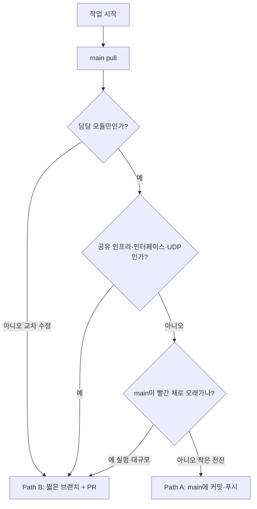

# 협업 가이드 (Phase 0/1 · Trunk · WIP · Path A/B)

> **문서 역할:** Canonical — Git workflow와 경로 ownership 정책
> **문서 허브:** [README.md](./README.md)
> **최종 수정:** 2026-07-25
> **목표:** Phase 0에는 개인 레포+안전한 ASMC 문서/인프라; Phase 1에는 모듈 ownership으로 `main`에 자주 합류.
> **필독:** §0.5 Phase · §2.5 WIP · §3 Path
> [team-dev-guide.md](./team-dev-guide.md) · [git-workflow.md](./git-workflow.md) · [network-udp-ros.md](./network-udp-ros.md)
> 로컬 현황: [`docs/competition/team-status.md`](../../docs/competition/team-status.md)

---

## 0. 팀 GitHub 계정

| GitHub | 이름 | 담당 |
|--------|------|------|
| [@ahnsh03](https://github.com/ahnsh03) | 안승현 | 통합 리드 · 인지 후보(차선/BEV/bake/Loc-Aid/sync) · bridge · Docker · docs |
| [@yuntae12-sudo](https://github.com/yuntae12-sudo) | 정윤태 | planning lead · behavior · MPC · launch |
| [@yangseojun](https://github.com/yangseojun) | 양서준 | MPC · behavior 공조 |
| [@kante2](https://github.com/kante2) | 이강태 | Frenet · UDP bridge (`aim_ws` `va`) |
| [@wkddnjsxo](https://github.com/wkddnjsxo) | 장원태 | TL (`traffic_runner`) · scenario |
| [@sonshiny](https://github.com/sonshiny) | 손재호 | 3D perception |

### 0.5 Phase 0 vs Phase 1 (필수)

| | **Phase 0 (~2026-08-07)** | **Phase 1 (8/7~)** |
|--|---------------------------|---------------------|
| 기능 개발 | **개인/분산 레포**에서 완성 (mpc_ws, va, traffic_runner, Det3D …) | ASMC로 이식 후 Path A/B |
| ASMC에 올리는 것 | 문서·Docker·interfaces·**안승현 인지 후보·eval 스텁** | Wave 2 모듈 전부 |
| 금지 | 남 파트 **미완성·빌드 깨짐** 코드를 ASMC `main`에 푸시 | 장기 개인 브랜치 누적 |

> Phase 0에도 “새 작업은 무조건 ASMC만”이 **아닙니다.** 개인 레포가 정상입니다. 8/7 이후 이식.

---

## 1. 왜 이 방식인가

| 현실 | 함의 |
|------|------|
| 인원 6명, 단일 레포 `2026-ASMC` | 장기 feature 브랜치 → merge 지옥이 빨리 온다 |
| 본선 = 시간+패널티, UDP 당일 강제 | **`main`이 항상 빌드·시뮬에 가깝게** 살아야 한다 |
| hybrid modular (룰+선택 학습) | 파트가 디렉터리로 이미 갈라짐 → ownership이 통한다 |
| 일정 촉박 | “매 커밋마다 checkout+PR”은 오버헤드가 큼 |

**채택 모델 이름:** *Module-owned trunk-based development*
(현업의 trunk-based + 모듈 소유. “모든 작업마다 PR”도, “아무 파일이나 main에 던져넣기”도 아님.)



---

## 2. 한 장 요약 (외울 것)

| # | 규칙 |
|---|------|
| 1 | **기본은 `main`.** 아침에 `git pull`, 저녁 전에 push. 브랜치를 오래 두지 않는다. |
| 2 | **자기 소유 디렉터리만** 고친다. ([§4](#4-모듈-소유권-ownership)) |
| 3 | **공유 파일·교차 파트·방향 전환** → 반드시 **짧은 브랜치 + PR** ([§3 Path B](#32-path-b--브랜치--pr-필수-게이트)). |
| 4 | `main`에 올린 커밋은 **빌드가 깨지지 않게**. 깨지면 즉시 fix 또는 revert. |
| 5 | 새 기능은 **ASMC에서만**. 개인 `aim_ws`/`mpc_ws`에 쌓지 않는다. |
| 6 | **개인 장기 브랜치 금지** (`va_seunghyun`, `jang`식 누적). |

> **요약 (Phase 1):** 소유 모듈 + 빌드 통과 → Path A (`main` 푸시). 공유·위험·WIP 공유 → Path B/Draft.
> **요약 (Phase 0):** 개인 레포에서 기능 완성. ASMC `main`에는 **초록(빌드·문서)만**.

---

## 2.5 WIP · 공유 · `main` 푸시 (초보 필독)

| | 해도 됨 | 하지 말 것 |
|--|---------|------------|
| **로컬 커밋** | 실행 안 되는 WIP, 실험 저장 | — |
| **`main` 푸시** | `./scripts/build_ws.sh` 통과 · 기존 실행을 깨지 않음 | 컴파일/런치 실패, “나중에 고칠게” |
| **공유만 목적** | `feature/…` 푸시 + **Draft PR**, 또는 **개인 레포** 링크 | 빨간 `main`에 직푸시 |

**체크리스트 — “실행은 안 되는데 팀에 보여주고 싶다”**

1. [ ] `main`에 푸시하지 않는다
2. [ ] `git checkout -b feature/<이름>-wip-…` 후 push
3. [ ] `gh pr create --draft` 제목에 `[WIP]`
4. [ ] PR 본문에 “안 되는 점 / 보고 싶은 점” 3줄
5. [ ] 빌드가 깨지면 Draft에 **알고 있음**이라고 적는다

**한 줄:** 커밋 = 내 히스토리. **`main` 푸시 = 팀 공용 상태** → 남이 pull 해도 빌드되게.

---

## 3. 두 갈래 워크플로 (Path A / B)

### 3.1 Path A — Trunk (`main`에서 일상 개발) ← **기본**

**언제:** 담당 패키지 안의 버그픽스, 튜닝, 로그, 소규모 기능 추가.
**조건:** 아래를 **모두** 만족.

- [ ] 변경 파일이 **내 ownership 경로만** ([§4](#4-모듈-소유권-ownership))
- [ ] `interfaces/`, `integration_launch/`, `docker/`, `.github/`, `MORAI-ROS_morai_msgs` **미포함**
- [ ] UDP↔시뮬 경계·공용 bridge 프로토콜 **미변경** (안승현·합의 없이)
- [ ] 로컬에서 `./scripts/build_ws.sh` (또는 해당 패키지) **성공**
- [ ] 커밋이 **작다** (한 주제, 가능하면 같은 날 push)

**절차**

```bash
cd <2026-ASMC>
git checkout main
git pull origin main
git submodule update --init --recursive

# ... 담당 경로만 수정 ...

./scripts/docker_ros_up.sh up   # 권장
docker exec -it asmc-ros-noetic bash -c './scripts/build_ws.sh'

git add src/<내-패키지>/
git commit -m "feat(mpc): tighten lateral cost near stop line"
git push origin main
```

**팀 매너**

- push 전 **한 번 더** `git pull --rebase origin main` (동시 푸시 충돌 최소화)
- 애매하면 카톡/디스코드에 “`mpc_controller` cost만 푸시함” 한 줄
- `main`이 CI 실패하면 **고친 사람이 우선 복구** (또는 통합 리드에게 즉시 알림)

### 3.2 Path B — 브랜치 + PR (필수 게이트)

**언제 (하나라도 해당하면 Path B):**

| 트리거 | 예시 |
|--------|------|
| **공유 인프라** | `docker/`, `scripts/docker_*`, `.github/`, submodule 핀 |
| **공용 계약** | `src/interfaces/`, msg 스키마, 토픽 이름, τ/tracks/TL 스펙 |
| **통합 launch** | `src/integration_launch/` (타 파트 include·토픽 연결) |
| **시뮬 경계** | UDP 포트·패킷, `udp_bridge.sh`↔시뮬 경로, Ctrl_cmd 매핑 |
| **교차 모듈** | perception 출력을 planner가 같이 바꿔야 함 |
| **방향·대형** | Phase B TL-Net 신규, UDP 전면 전환, 아키텍처 큰 변경 |
| **실험** | 며칠 `main`을 빨간 채로 둘 수 있는 스파이크 |

**절차 (수명: 수시간~최대 2~3일, 그 이상이면 쪼개기)**

```bash
git checkout main && git pull origin main
git checkout -b feature/yuntae-udp-ctrl-cmd

# 작업 · 빌드 · (가능 시) 시뮬
git push -u origin feature/yuntae-udp-ctrl-cmd
gh pr create --title "feat(udp): Ctrl_cmd path for finals" --body "..."
```

- PR template: [.github/pull_request_template.md](../.github/pull_request_template.md)
- 리뷰: CODEOWNERS + 관련 파트 리드. **작게, 자주 merge.**
- merge 후 로컬 브랜치 삭제, `main` pull.

**Draft PR:** 방향만 물어볼 때. merge 전에는 Ready로 전환.

### 3.3 Path C — 선택적 짧은 PR

소유 모듈이어도 **리뷰를 받고 싶을 때** (알고리즘 리뷰, 첫 대규모 커밋).
강제 아님. Path A로 가도 되고, 짧은 PR로 눈을 빌려도 됨.

---

## 4. 모듈 소유권 (ownership)

> **핵심:** “main에서 같이 일한다” = **같은 파일을 동시에 막 고친다**가 아니다.
> **디렉터리를 나눠 각자 main에 자주 올린다.**

| 경로 | Owner | Path A 직푸시 | Path B 필수 |
|------|-------|---------------|-------------|
| `src/behavior_planner/` | 정윤태 · 양서준 | ✅ | 스키마·타 파트 계약 변경 시 |
| `src/mpc_controller/` | 정윤태 · 양서준 | ✅ | |
| `src/planner/` | 이강태 | ✅ | behavior msg 동시 변경 시 |
| `src/perception/morai_3d_detection/` | 손재호 | ✅ | |
| `tools/aim_scenario_runner/`, `tools/grpc_inha_univ/` | 장원태 | ✅ | |
| `src/learning_by_cheating/` | 안승현 | ✅ | |
| `scripts/udp_bridge.sh` · `scripts/rosbridge.sh` · 포트 설정 | 안승현·이강태 | ⚠ 소규모만 | **시뮬 경계·포트·프로토콜 → B** |
| `src/integration_launch/` | 정윤태 (+통합) | ⚠ 단독 include만 | **토픽 연결·타 파트 → B** |
| `src/interfaces/` | 통합 리드 | ❌ | **항상 B** |
| `docker/`, `.github/`, `docs/` 규약 | 안승현 | docs 소수정정 ✅ | docker/CI → **B** |
| `src/MORAI-ROS_morai_msgs/` | 안승현 only | ❌ | **항상 B** (핀 변경) |

전체 트리: [repository-layout.md](./repository-layout.md) · 개인별: [team-dev-guide.md](./team-dev-guide.md)

### 남 영역이 필요할 때

1. 카톡/노션으로 **Owner에게 먼저** 알린다.
2. 가능하면 Owner가 고친다.
3. 같이 고쳐야 하면 **Path B 공동 PR** (둘 다 리뷰어).

---

## 5. 커밋·푸시 습관 (trunk가 깨지지 않게)

### 5.1 커밋 메시지

```
feat(scope): 한 줄 요약
fix(scope): 버그 수정
docs: 문서만
chore(docker): Docker 설정
refactor(planner): 동작 변경 없는 리팩터
```

`scope`: `mpc`, `planner`, `behavior`, `perception`, `scenario`, `bridge`, `udp`, `lbc`, `docker`, `integration`

### 5.2 빈도

| 권장 | 비권장 |
|------|--------|
| 하루 1회 이상 `main`에 의미 있는 전진 push | 로컬에만 1주일 쌓기 |
| 한 커밋 = 한 의도 | “WIP 전부” 한 방에 푸시 |
| push 직전 pull --rebase | main과 일주일 분기 |

### 5.3 `main`이 깨졌을 때

1. CI/빌드 실패 발견자 → 채널에 알림
2. 원인 커밋 작성자가 **fix 커밋** 또는 `git revert`
3. 30분 이상 방치 금지 (대회 리허설·타인 작업 차단)

---

## 6. 브랜치 이름 (Path B일 때만)

| 패턴 | 예 |
|------|-----|
| `feature/<이름>-<기능>` | `feature/yuntae-udp-ctrl-cmd` |
| `fix/<이름>-<이슈>` | `fix/jaeho-lidar-crash` |
| `docs/<이름>-<주제>` | `docs/seunghyun-trunk-workflow` |
| `integrate/<모듈>` | `integrate/interfaces-tracks` |

### 수정 권한 요약

| 경로 | 주 담당 |
|------|---------|
| `src/behavior_planner/`, `src/mpc_controller/`, `src/integration_launch/` | 정윤태·양서준 |
| `src/frenet_planner/` | 이강태 |
| `src/learning_by_cheating/`, `scripts/bridge*` | 안승현 |
| `src/perception/morai_3d_detection/` | 손재호 |
| `tools/aim_scenario_runner/`, `tools/grpc_inha_univ/` | 장원태 |
| `docker/`, `docs/` (규약), `interfaces/` | 통합 리드 |

전체 매트릭스: [repository-layout.md](./repository-layout.md) §3

**금지:** 개인 단일 장기 브랜치에 모든 작업 누적.

---

## 7. 충돌·리베이스

| 상황 | 해결 |
|------|------|
| Path A에서 push 거절 (non-fast-forward) | `git pull --rebase origin main` → 충돌 해결 → `git push` |
| Path B가 main보다 뒤처짐 | `git fetch && git rebase origin/main` → `--force-with-lease` |
| 같은 패키지 동시 수정 | ownership 위반 점검 → 한쪽이 rebase, 또는 작업 시간 조율 |
| `integration_launch` conflict | planning·통합 리드 조율 |

```bash
# Path A 충돌
git pull --rebase origin main
# 충돌 파일을 내 담당 기준으로 해결
git add .
git rebase --continue
git push origin main
```

---

## 8. GitHub 설정 (통합 리드)

`main` 직푸시를 쓰려면 저장소 설정이 문서와 맞아야 한다.

| 권장 설정 | 이유 |
|-----------|------|
| 팀원에게 `main` **push 허용** (또는 write) | Path A |
| **Required PR** 은 끄거나, CODEOWNERS 경로만 제한적으로 | “매 커밋 PR” 방지 |
| CI는 `push` to `main` + PR 모두 실행 | 직푸시 후에도 빌드 감시 |
| Path B 필수 경로는 CODEOWNERS로 리뷰 요청 | interfaces·docker 등 |

설정 변경은 **안승현**이 GitHub에서 적용하고, 변경 시 팀에 공지한다.

---

## 9. 개발 환경·검증

| 환경 | 역할 |
|------|------|
| PC + Docker (`asmc-ros-noetic`) | 일상 빌드·실행 |
| Ubuntu 네이티브 | 대회 리허설 (UDP·지연) |
| WSL | Docker Desktop WSL Integration |

```bash
# push / PR 전 최소
./scripts/docker_ros_up.sh up
docker exec -it asmc-ros-noetic bash -c './scripts/build_ws.sh'
```

시뮬: [sim-verification-checklist.md](./sim-verification-checklist.md)

---

## 10. 체크리스트

### Path A (`main` 직푸시) 전

- [ ] `main` 최신 pull
- [ ] 내 ownership 경로만
- [ ] **빌드 성공** (WIP·빨간 코드 아님 — §2.5)
- [ ] 공유 인프라·interfaces·UDP 경계 아님
- [ ] `git push origin main`

### Path B (PR) 전

- [ ] 수명 짧게 (목표 1~2일 내 merge)
- [ ] PR template 작성 · Path B 사유 명시
- [ ] CODEOWNERS 리뷰
- [ ] 빌드·(가능 시) 시뮬
- [ ] merge 후 브랜치 삭제 · `main` pull

---

## 11. CODEOWNERS · CI

- CODEOWNERS: [.github/CODEOWNERS](../.github/CODEOWNERS)
- CI: [.github/workflows/ci.yml](../.github/workflows/ci.yml) — PR 및 `main` push 시 `catkin_make`

---

## 관련 문서

- [git-workflow.md](./git-workflow.md) · [network-udp-ros.md](./network-udp-ros.md) · [perception-agentic-loop.md](./perception-agentic-loop.md)
- [CONTRIBUTING.md](../CONTRIBUTING.md) · [team-dev-guide.md](./team-dev-guide.md) · [integration-plan.md](./integration-plan.md)
- 로컬: [team-status.md](../../docs/competition/team-status.md)
