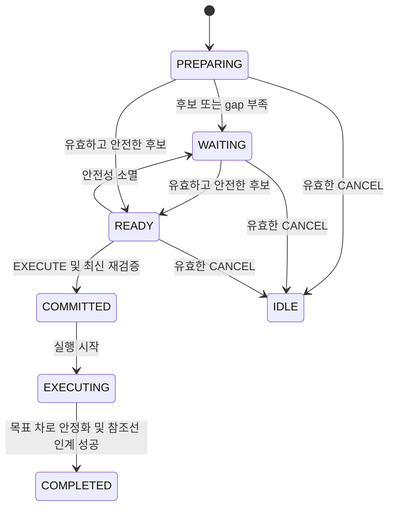

# 고주로 합류·차선변경 전환 계약 v1 — 설계 기준안

> 상태: **고주로 진입 후보·간격 판단·참조선 인계 연결(기본 비활성, MORAI 수락 대기)**. 기준 main
> `fcfe8c587f09f27a3f6aa25e500f97299dd71e15`를 기준으로 작성했다.
> 이 문서는 다음 구현의 소유권·전이·검증 조건을 정한다. 기존
> [FSM↔Frenet v2](./planning-fsm-frenet-v2.md)의 frozen wire 계약을 대체하지 않는다.
> 공용 message, enum, MD5는 유지하고 고주로 정책은 명시적으로 활성화할 때만 적용한다.

## 1. 목적과 첫 구현 범위

고주로 진입 합류, 차로 감소에 따른 필수 이동, 선택적 추월은 같은 차로 전환
실행기를 사용하되 요청 사유와 허용 정책을 구분한다. 첫 구현 범위는
**일반 주행 고주로 진입 판단·실행 연결**이다. 차로 감소의 필수 차선변경,
선택적 추월은 이 연결을 검증한 뒤 순차 구현한다. 현재 범위와 실행·검증 방법은
[고주로 진입 1차 구현](../../src/asmc_planner/docs/highway-merge-stage3.md)에 정리한다.

정적 장애물 AVOID는 보통 원래 참조선으로 복귀하는 동작이다. 차선변경은
목표 차로에서 계속 주행하는 동작이다. 두 동작의 완료·참조선 정책을
혼동하지 않는다. 기존 회전교차로 MERGE는 현행 실행기를 유지하며,
고주로 개발을 이유로 함께 재작성하지 않는다.

## 2. 확인한 현재 구현

| 경계 | 현재 상태 | 추가로 필요한 계약 |
|---|---|---|
| Behavior → Execution | command_id, PREPARE/EXECUTE/CANCEL, source/target link, target pose 제공 | 링크 한 개를 넘어 목표 차로의 전후 연결과 사용 가능 구간 확인 |
| Execution → Frenet | COMMIT 원자성, 활성 transaction 유지, 동일 ID 피드백 결합 | 차로 전환 완료와 참조선 인계의 원자성 |
| LaneChange core | 기존 참조선에 target pose를 투영하고 target_d를 잠금 | 실제 목표 차로 곡선을 따라가는 전환 corridor |
| LaneChange lifecycle | 위치·횡속도·기존 참조선 heading 조건으로 SHIFT → HOLD_TARGET_LANE | 목표 차로 기준 정렬과 footprint 확인 후 인계·COMPLETED |
| Reference | 단일 RefLine, 그 참조선의 s/d | 미션 진행 기준과 활성 주행 참조선 구분 |
| Controller 입력 | map frame Cartesian trajectory | 내부 참조선 변경 전후 궤적 연속성과 시각 의미 보존 |

구현 근거:

- `src/asmc_planner/src/Frenet/Maneuver/LaneChange/LaneChange.cpp`
- `src/asmc_planner/src/Frenet/Maneuver/LaneChange/LaneChangeLifecycle.cpp`
- `src/asmc_planner/src/Planning/Compatibility/lane_change_commit_coordinator.hpp`
- `src/asmc_planner/src/Execution/Acceptance/CommandFingerprint.cpp`
- `src/asmc_planner/src/Execution/Acceptance/CommandExecutionManager.cpp`
- `src/asmc_planner/src/Frenet/Reference/Reference.hpp`

독립 LANE_CHANGE wire 명령의 HOLD_TARGET_LANE은 의도적으로 COMPLETED를 발행하지 않는다.
여기에 완료 상태만 추가하면 다음 KEEP이 기존 글로벌 참조선으로 돌아갈 수
있기 때문이다. 고주로 MERGE는 공유 인계 실행기를 통해 목표 차로 채택과
COMPLETED를 함께 적용한다. 독립 LANE_CHANGE 정책의 일반화는 후속 범위다.

## 3. 소유권과 데이터 의미

아래 이름은 **제안하는 내부 C++ 데이터 개념**이다. 새 ROS message 선언이나
현재 존재하는 API를 뜻하지 않는다.

| 개념 | 단일 소유자 | 계약 |
|---|---|---|
| MissionRoute | 기존 route/map 소비 경계 | 공식 경로 순서, CP, 미션 속도 구간, 경로 복귀 필요성을 소유 |
| ActiveLaneReference | Planning/Reference 경계 | 현재 주행할 차로의 연결된 link sequence와 곡선, ref_epoch 소유 |
| TransitionRequest | Behavior | 진입/필수차선변경/추월 사유, 방향, source/target lane, 완료 가능 기한 요청 |
| TransitionExecution | Execution | command 결합, PREPARE/COMMIT, 진행, 취소·중단, 참조선 인계 소유 |
| TransitionPlan | Frenet | 준비·횡이동·안정화 궤적, 충돌·운동학·차로 경계 검사 |
| Trajectory tracking | Controller | 승인된 map trajectory 추종; 차로 선택과 기동 완료를 독자 판단하지 않음 |

필수 식별·시각 정보:

- mission route revision, map build_id/geometry hash, active ref_epoch.
- source/target lane sequence와 각 reference의 유효 범위.
- 기존 command_id와 해당 transaction의 원본 목표.
- ego/object source stamp, 평가 시각, 후보의 유효 기간.
- 합법적인 경계 횡단 구간, 차로 끝, 필수 복귀 완료 한계, CP 도달 가능성.

map topic의 동일 build/hash 규칙은 기존 [HD Map runtime 계약](./hd-map-runtime-v1.md)을 따른다.
관측이 없거나 오래된 상태를 `clear`로 만들지 않는다. free/occupied/unobserved의
관측 의미를 구분하며 실제 센서 가시범위 검증은 후속 인지 수락 조건이다.

### 3.1 두 종류의 s/d

- `route_s`: 공식 미션 경로 기준 진행 위치. CP·미션 구간 조회에 사용한다.
- `lane_s/lane_d`: 활성 주행 차로 기준 상태. 궤적 생성과 같은 차로 객체 투영에 사용한다.

참조선이 바뀌어도 route_s를 새 lane_s로 덮어쓰지 않는다.
현재 FrenetFeedback의 current_s/current_d는 해당 Frenet 참조선 좌표라는 기존
의미를 유지한다. 좌표가 달라진 경우 동일한 ego의 map pose/velocity에서 다시
투영하며, 이전 ref의 s_hint나 target_d를 새 ref에 복사하지 않는다.

공식 경로와 활성 차로를 대응시키는 매핑은 연결·방향·진행 구간으로 제한한다.
전역 최근접 링크만으로 차로를 매 tick 교체하지 않는다. 병렬 차로, 교차 도로,
GPS 불량, lap reset을 별도로 처리해야 한다.

### 3.2 기존 command identity 보존

현재 fingerprint에는 source/target link, target pose, desired_speed 및 preferred
front/rear ID도 포함된다. 같은 command_id로 이 값을 매 tick 고치지 않는다.

- PREPARE 중 목표 변경이 필요하면 현행 취소/새 transaction 절차를 사용한다.
- COMMIT 후에는 현재 target lane/reference 결합을 유지한다.
- 주변 차량 관측과 실제 적용 속도는 내부 안전 재평가로 갱신한다. front/rear의
  ID 변경이 물리적인 gap의 소멸 또는 확보를 자동으로 뜻하지 않는다.
- EXECUTE 요청만으로 READY 후보를 믿지 않고 최신 입력과 동일 ref_epoch로
  안전성을 다시 검사한다.
- 공용 payload 확장이 필요해지면 별도 version/owner 협의로 다룬다. reason이나
  result_detail 문자열을 기계 제어용 새 필드처럼 해석하지 않는다.

## 4. 상태 전이

기존 public 상태를 그대로 사용한다.

- READY는 지금 평가한 후보가 실행 가능하다는 뜻이며 이동 시작 또는 완료가 아니다.
- EXECUTING 내부에 횡이동·안정화·참조선 인계 단계를 둔다. public enum을 늘리지 않는다.
- 일반 scoring의 KEEP/FOLLOW 변경으로 실행 중 횡기동을 덮어쓰지 않는다.
  실행 중 선행차 추종과 감속은 해당 corridor 위의 종방향 제약으로 처리한다.
- 합류 후보가 없을 때 현재 차로에서 가능한 KEEP/FOLLOW/감속 궤적 발행을
  계속한다. 합류 탐색 실패가 유효 궤적 발행을 막아서는 안 된다.
- 차로 끝·장애물로 더 진행할 수 없다면 검증된 현재 corridor 안에서 감속한다.
- EMERGENCY_STOP 선점은 유지한다. 단, 참조선의 유효성·실제 차체 위치를
  무시한 원래 차로 복귀나 조향 0 입력을 뜻하지 않는다.

### 4.1 취소와 안전 복귀

COMMIT 전 취소는 기존 CANCEL → IDLE 규칙을 따른다.
COMMIT 뒤 위험이 생겼다고 기존 참조선 KEEP으로 즉시 바꾸지 않는다.

1. 현 상태에서 목표 차로 계속 진행, 안전 복귀, corridor 내 감속의 가능성을 재검사한다.
2. 안전 복귀는 실제 ego 상태에서 새로 생성·검사한 궤적으로 실행한다.
3. 복귀 중에는 내부 recovery 상태를 사용한다. 원래 목표 차로에 도착했다는
   COMPLETED를 발행하지 않는다.
4. 복귀와 상태 재정리가 완료되면 실패 종료와 새 정상 주행 transaction을
   명시적으로 연결한다. 수행 불가 상태에서도 궤적·입력 유효성은 별도 검사한다.

이 recovery는 아직 미구현이다. 현재 TOO_LATE_TO_CANCEL을 무조건 해제하는
수정으로 대체하지 않는다.

## 5. 완료 및 참조선 인계

차선 중심 근처를 지나거나 progress가 1이 되는 것만으로 완료하지 않는다.
다음 조건을 **목표 차로 기준**으로 만족해야 한다.

- 차체 footprint가 목표 차로의 사용 가능한 영역 안에 있음.
- 횡위치, heading, 횡속도 오차가 정해진 한계 안에서 일정 시간 유지됨.
- 계획된 횡단 구간을 지나 안정화 구간에 도달함.
- 목표 차로에서 이어지는 KEEP/FOLLOW 궤적을 실제 생성·검증할 수 있음.
- map/route/ref 버전과 입력 상태가 인계 직전까지 유효함.

한 planning cycle의 인계 순서:

1. 목표 reference와 이후 주행 궤적을 read-only로 준비·검증한다.
2. 새 reference에 ego, 관련 객체, leader/gap 판단을 다시 투영한다.
3. 겹치는 동일 시각 구간에서 기존 전환 궤적과 새 궤적의 위치·heading·곡률·
   속도·가속도 연결이 제어 한계를 만족하는지 확인한다.
4. 실패할 수 있는 준비·변환을 끝낸 후 기존 command_id의 완료 전이를 검증한다.
5. 같은 callback에서 완료 전이와 active lane/reference/ref_epoch, 해당 좌표의
   캐시 및 다음 궤적을 함께 적용한다. 중간 상태를 외부에 발행하지 않는다.
6. 다음 KEEP/FOLLOW는 새 active reference를 사용한다.

하나라도 실패하면 일부 상태만 갱신하지 않는다. 유효 기간과 최신 충돌 검사를
만족하는 기존 corridor 궤적 또는 가능한 제동 궤적을 유지한다.
미래 입력을 기다리며 오래된 궤적을 무제한 재사용하지 않는다.

인계는 내부 좌표 기준의 변경이다. Controller에는 연속적인 map trajectory를
보내며, 인계 사실만으로 MPC warm-start 전체를 무조건 초기화하지 않는다.
기존 controller의 reference 유효성·연속성 검사와 source timestamp 의미를 보존한다.

기존 LC의 위치·횡속도·heading tolerance는 시험의 출발점으로 참고하되,
목표 차로 footprint·인계 연속성·안정화 시간의 수치는 아직 검증되지 않았다.
이번 문서에서 안전 검증이 끝난 값으로 고정하지 않는다.

## 6. 미션 경로·종료 구간

새 차로를 채택한 뒤의 KEEP은 그 차로를 계속 주행한다.
원래 글로벌 polyline에서 벗어났다는 이유만으로 즉시 복귀하지 않는다.

반대로 차로가 없어지거나 CP/출구가 요구하는 차로로 갈 수 없다면 선택적 이동을
허용하지 않는다. 차로 감소, 차선 횡단 허용 구간, 복귀 소요 거리와 안정화 구간을
고려해 완료 한계를 계산한다. 차로 끝 한 점을 하드코딩한 거리로 대신하지 않는다.

현재 metadata의 고주로 예외 구간은 route_s 약 1118.742–1741.721 m다.
이 구간 전체가 차선변경 가능 구간이라는 뜻은 아니다.
CP10/11/12의 순서와 3 m 통과 조건, 테이퍼·안전지대·실제 차선 연결을
동시에 만족해야 한다. 전체 lane graph의 연결·횡단 가능 여부 검증은 후속 단계다.

## 7. Autoware에서 참고하는 경계

2026-10-15 공식 문서 조회 기준:

- Mission Planner의 route section은 선호 차로와 같은 방향의 이웃 차로들을
  묶어 표현한다. 단일 중심선 polyline만을 전역 경로로 사용하는 구조와 차이가 있다.
- Lane Change는 준비 구간과 횡이동 구간 후보를 만들고 유효성·안전성을 검사한다.
- Planner Manager는 candidate/approved module과 동시 실행 우선순위를 관리한다.
- 일반 회피 뒤에는 root reference를 유지하지만, 성공적인 차선변경 뒤에는
  현재 route lanelet을 재설정하여 이후 주행 차로를 반영한다.
- 완료 판단에는 목표 차로 확인과 종방향 진행 또는 횡위치·heading 조건이
  사용된다. 준비 중 CANCEL과 횡이동 중 ABORT를 구분한다.

참고한 공식 문서:

- [Mission Planner](https://github.com/autowarefoundation/autoware_universe/blob/main/planning/autoware_mission_planner_universe/README.md)
- [Lane Change design](https://autowarefoundation.github.io/autoware_universe/latest/planning/behavior_path_planner/autoware_behavior_path_lane_change_module/)
- [Planner Manager design](https://autowarefoundation.github.io/autoware_universe/latest/planning/behavior_path_planner/autoware_behavior_path_planner/docs/behavior_path_planner_manager_design/)
- [Behavior Path Planner](https://autowarefoundation.github.io/autoware_universe/latest/planning/behavior_path_planner/autoware_behavior_path_planner/)

우리 구조는 Behavior/실행 관리/경로 생성/제어라는 계층 구분에서 유사하다.
Autoware의 PathWithLaneId·후단 velocity/motion planning과 우리 Frenet/MPC는
동일한 pipeline이 아니다. module manager 전체 이식 대신 단일 실행 소유권,
승인 후 재검사, 목표 차로 채택, 연속적인 인계를 적용한다.

## 8. 기존 bag으로 확인한 범위와 후속 검증

이번 확인은 **저장된 메시지의 관찰**이다. 최신 main을 실행해 재계산한
bag replay나 새 차선변경의 closed-loop 시험을 수행한 것은 아니다.

기존 feature_debug의 ego_s가 1118.741751169–1741.720988511 m인
샘플을 고주로 예외 구간으로 구분했다. command는 직전 feature와 0.3 s 이내인
경우만 결합했다. 이 0.3 s는 이번 집계의 결합 기준이며 runtime freshness
파라미터가 아니다.

| bag 기록 | 구간 feature 수 | 결합 command 수 | KEEP | FOLLOW | E-STOP | LC / 고주로 MERGE |
|---|---:|---:|---:|---:|---:|---:|
| 20261012-093505 | 787 | 781 | 723 | 52 | 6 | 0 / 0 |
| 20261012-131053 | 1235 | 1235 | 1107 | 120 | 8 | 0 / 0 |
| 20261012-140026 | 1196 | 1195 | 1099 | 76 | 20 | 0 / 0 |

20261012-070020은 해당 구간 도달 전 종료했다.
위 세 기록의 **전체 command에서도** LANE_CHANGE 및 MERGE_HIGHWAY가 없었다.
기존 bag만으로 전환 후 실제 조향 추종·완료 성공을 입증할 수 없다.

| 시험 | 수락 조건 | 현재 상태 |
|---|---|---|
| 기존 bag 내용·입력 가용성 조사 | 고주로 및 기존 maneuver 구간 식별 | 위 집계 완료 |
| disabled/shadow 회귀 | 새 기능 비활성 시 기존 command/trajectory 출력 회귀 없음 | 구현 후 replay 필요 |
| lifecycle 단위 시험 | 오래된 READY, 목표 변경, CANCEL, 인계 실패가 잘못된 COMMIT/완료를 만들지 않음 | 인계 owner의 완료 거부·snapshot 변경 검사 구현; 전체 전이 회귀는 후속 |
| 합성 직선·곡선 전환 | target lane 기준 정렬·footprint·연속성 확인 | 후속 구현 |
| 완료 후 KEEP/FOLLOW | 새 ref 유지, 이전 차로로 튀지 않음, ref_epoch 1회 증가 | native 검사 통과, 전용 runtime의 실제 추종 미검증 |
| 입력/지도 실패 주입 | unobserved를 clear로 오인하지 않음; 부분 인계 없음 | stale/버전 변경/충돌 거부 native 검사 구현; 가시범위 계약은 후속 |
| 기존 bag shadow gap 평가 | 전방·후방·준비/횡이동/안정화 시간 전체를 평가 | geometry/관측 계약 구현 후 |
| simulator closed-loop | 실제 LC 추종, rear approach, 좁은 gap, lane end, abort 확인 | 마지막 단계 |

진행 순서는 **내부 reference/transaction 계약 시험 → 빈 차로 인계 →
기존 bag shadow gap 검증 → 고주로 진입 → 필수 차선변경 → 선택적 추월**이다.
각 단계에서 현행 STOP/FOLLOW/AVOID/회전교차로 회귀를 확인한다.
수동 주행 성공 또는 고정 ego 궤적 bag의 후보 성공을 closed-loop 안전 증거로
대체하지 않는다.

## 9. 단계별 구현과 rollback

[차로 참조선 기반 단계](../../src/asmc_planner/docs/lane-reference-stage1.md)에
구현 API, 검증 결과와 실행법을 기록했다. 같은 build/hash의 HD-map 계층을
불변 snapshot으로 변환하고, 명시한 차로 sequence의 참조선을 생성·검사한다.
목표 차로 정렬 검사는 command/ref epoch와 source stamp에 결합한다.

`GEOMETRY_ELIGIBLE`은 여전히 기하 조건만 만족했다는 내부 결과다.
public READY/COMPLETED로 직접 변환하지 않는다.

[2단계 참조선 인계 시험](../../src/asmc_planner/docs/lane-reference-stage2.md)은
별도 opt-in runtime에서 최신 ego·객체·선행차·후속 KEEP/FOLLOW를 준비하고,
충돌·도로·연속성과 완료 전이까지 성공했을 때 owner를 교체한다. 일반 Behavior와
미션 소비자는 변경하지 않았다. 따라서 CP/미션 판단까지 연결된 production
인계나 고주로 gap 승인 구현으로 해석하지 않는다.

기존 planner/controller 실행 경로, 인지/지도 producer, 공용 메시지와 기존 주행
YAML은 유지한다. 새 시험 launch와 설정을 명시적으로 선택할 때만 동작한다.
기존 bag·생성 집계 파일은 커밋하지 않는다. 각 단계의 커밋을 revert하면 그 단계의
API·도구·build 등록을 제거할 수 있고 일반 launch로 돌아갈 수 있다.
