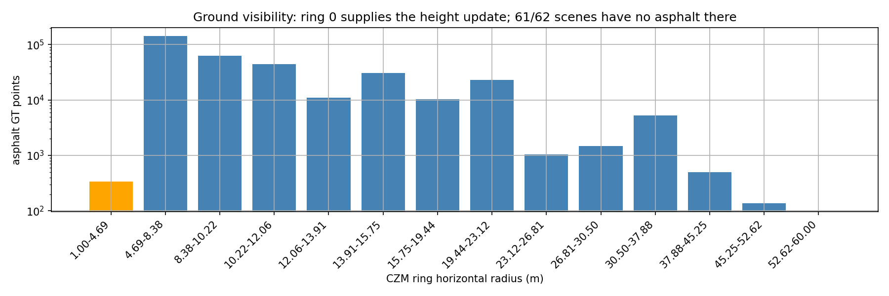
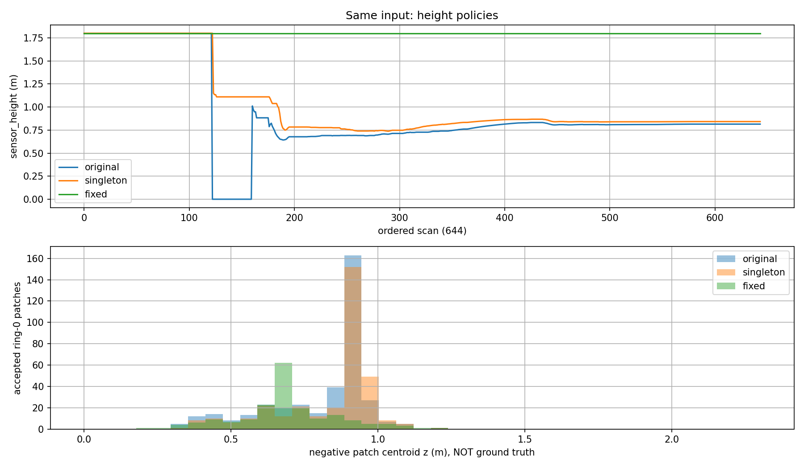
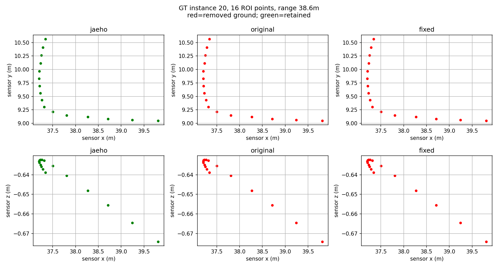
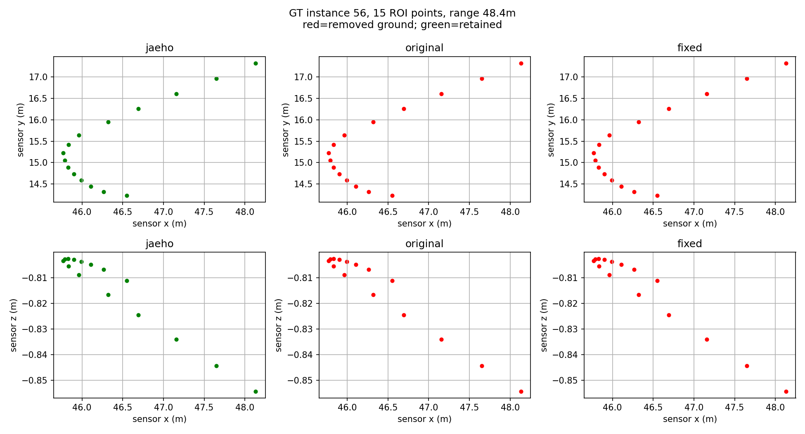

# Patchwork++ 높이 갱신과 지면 관측 범위 검증

L2-A2-H1은 **격리 구현과 비교를 완료했지만 운영 채택은 보류**한다. 단일 표본 평균 오류를
막는 것만으로 높이 드리프트가 해결되지는 않았다. 1.80m 고정 높이는 연속 bag의 높이
붕괴를 막았지만 낮은 부분의 삭제가 늘었고, Capture의 차량 완전 소실 2건은 그대로다.
따라서 높이 안정화와 객체를 지면으로 오인하는 문제를 분리해 다음 지면 검토로 넘긴다.

기준 commit은 `cb0ccb9`, 독립 브랜치는 `feat/asmc-lidar-runtime`이다. 손재호 고정 소스
`6435af1`과 vendored Patchwork++ `3e6903a1`은 변경하지 않았다. 수정은
[격리 평가 도구](../../../tools/lidar/height_review/README.md)의 빌드 산출물에만 적용한다.
기존 ROS 기본값, `/last_lidar`, `/lidar_nogps`, 판제·메시지·HD맵·센서 설정에는 변경이 없다.

## 비교 정책과 원인 분리

| 비교군 | 변경 |
|---|---|
| 재호 | 기존 일반도로 pitch 수평화와 RANSAC 지면·수직 평면 제거 |
| original | 고정 Patchwork++ 그대로, 진단만 추가 |
| singleton | elevation 갱신 history가 2개 미만이면 해당 갱신 보류 |
| fixed | singleton 수정에 더해 sensor_height만 1.80m 유지 |

fixed에서도 지역별 elevation·flatness 학습은 계속한다. 공용 평균 함수와 TGR, CZM 구역,
임계값, 군집·OBB는 바꾸지 않았다. 주 비교는 pitch와 10cm voxel이고, raw 및 full
roll/pitch는 별도 대조군이다. GT나 HD맵은 알고리즘 입력에 사용하지 않았다.

`sensor_height`는 센서 원점과 노면의 관계를 나타내는 지면 추정 초기값이다. rear-axle
기준 `base_link`의 장착 z=1.45m와 다르다. 이전 노면 관측 약 1.77~1.78m를 정확한 상수로
단정하지 않고, 기존과 같은 1.80m로 고정해 높이 갱신 효과만 비교했다. Patchwork++ 코어는
IMU를 직접 받지 않으며 입력 수평화는 어댑터가 수행한다. 이번에 deskew를 구현하지 않았다.

원본 `calc_mean_stdev`는 표본 1개에서 평균을 계산하지 않지만, 호출부가 초기 평균 0을
높이에 반영한다. singleton은 이 호출부만 수정한다. 별도로, 높이 학습은 첫 concentric
ring의 patch에 의존한다. 현재 min/max 설정 1/60m에서 첫 ring은 **1~4.6875m**다.
높이 1.80m, 최하향 빔 15도의 평지에서는 최초 지면 교차 반경이 약 **6.718m**다.
이는 센서 기하 계산이며, 실제 경사·자세·가림을 무시한 평지 가정이다.

일반도로 Capture의 아스팔트 GT를 확인하면 62장면 중 61장면의 첫 ring에 해당 점이 없다.
예외 1장면에는 336점이 있고 아스팔트 전체 median z가 약 -1.04m로 다르다. 예외를
제외하거나 모든 장면에 동일 높이를 맞추지 않았다. 이 결과는 **현재 높이 학습 구역의
관측 적합성이 부족하다는 근거**이며, 구역을 넓히면 모든 문제가 해결된다는 증명은 아니다.

## 입력과 재현 검증

| 입력 | 수량과 용도 | 제한 |
|---|---|---|
| 수동주행 raw bag | 동일 순서 644스캔, IMU와 높이 변화 | semantic GT 없음 |
| 정차 bag | 5구간 129스냅샷, 구간마다 초기화 | 음영 구간 포함, 일반도로 정확도와 합산 금지 |
| 과거 일반도로 Capture | 62장면, ROI 내 10점 이상 객체 35관측 | 과거 10Hz 센서, IMU 없음, 독립 시험 세트 아님 |
| 기존 v3 Capture | 105장면의 missing/empty 210조건 | 터널 기준선 회귀이며 이번 일반도로 GT와 별개 |

bag의 원래 나노초 stamp를 유지한다. 과거 추출기는 도착한 유효 IMU 중 마지막 표본만
기억하므로, 더 이른 적격 IMU가 있어도 마지막 표본이 미래 stamp이면 scan을 제외할 수
있다. 이번에는 이 보수적인 선택을 그대로 재현했다. 이력을 검색하는 새로운 선택기로
평가 집합을 넓히지 않았다. 수동주행 645개 추출 중 arrival-before-stamp인
`manual_all_000258`만 기존대로 제외해 644개를 고정했다. Capture의 0 자세와 순서용
timestamp는 실측 IMU·촬영시각이 아니라고 metadata에 명시했다.

- 원본 bag 재추출 결과와 영구 입력 manifest가 **바이트 단위로 동일**했다. 입력 905개
  파일은 크기·SHA로 고정했고, 원본 bag은 복사하거나 수정하지 않았다.
- original 분류 마스크는 과거 출력과 **644/644, 129/129, 62/62** 완전 일치했다.
  과거 높이 JSON은 12자리 출력이므로 높이 비교만 1e-10 오차를 허용했다.
- 재호 수동주행 644스캔의 ground/other-plane 마스크도 기존 결과와 일치했다.
  과거 평가의 wall→nonground 표시 변환은 비교할 때만 되돌려 설명했다.
- 33개 조건 조합을 각각 두 번 실행해 시간 계측을 제외한 마스크·진단이 모두 동일했다.
  반복 실행 횟수를 독립적인 주행 장면 수로 세지 않는다.
- 평지·오르막·내리막·roll/pitch·지면 없이 객체 평면만 있는 5개 합성 조건을 3정책으로
  반복했다. 이는 분석용 광선 합성이며 MORAI의 실제 발사순서·스캔 시간을 재현하지 않는다.
- 13개 잘못된 입력, 단일·빈 표본 경계, 기존 core/frame/IMU 시험, 기존 입력 계약 6개,
  기존 LiDAR Python 63개와 터널 210조건 parity가 통과했다. 공유 B1 코어 CTest와
  JSONL/나노초·변환 계약 9개도 다시 통과했다.

## 연속 입력 결과와 기하 추정 지표

수동주행 644스캔의 주 비교다. road/low는 국소 평면을 기준으로 만든 **기하 proxy**이며,
실제 도로·낮은 장애물의 정답 라벨이 아니다. low 삭제율은 작을수록 유리한 참고 지표다.

| 방법 | 높이 1.4m 미만 프레임 | 마지막 높이 | road proxy 지면 제거 | low proxy 지면 제거 |
|---|---:|---:|---:|---:|
| 재호 | 해당 없음 | 해당 없음 | 94.070% | 56.422% |
| original | 522 | 0.815m | 92.487% | 23.316% |
| singleton | 521 | 0.842m | 92.660% | 24.054% |
| fixed | 0 | 1.800m | 94.375% | 26.593% |

단일 표본 수정은 0m 급락만 없애고 잘못된 높이 학습 자체는 막지 못했다. fixed는 road
제거가 1.888%p 증가했지만 low 삭제도 3.277%p 증가했다. 따라서 모든 보존 성능이 좋아진
것은 아니다. 재호가 별도로 제거하는 수직 평면점은 지면 제거율에 더하지 않았다.
JSON에는 ground·vertical·retained·ROI 밖/미분류를 별도로 남겼다.

fixed의 raw/pitch에서는 road 95.201%, low 27.366%가 지면으로 제거됐다.
fixed의 voxel/full-RP에서는 road 95.178%, low 38.298%로, pitch보다 low 삭제가
11.705%p 증가했다. **full-RP를 무조건 더 안전한 기본값으로 채택하지 않는다.**
정차 구간별 결과는 summary의 phase_proxy_metrics에서 따로 확인하며 터널 벽점이 섞일
수 있는 통합 proxy를 일반도로 검출 정확도로 해석하지 않는다.

## GT 객체 보존과 남은 차량 소실

같은 voxel 표현의 Capture 주 비교다. PP 세 정책의 첫 프레임 분류는 같았다.
각 장면을 초기화하며 높이 갱신이 분류 뒤에 일어나기 때문이다. 이것은 높이 후보 효과를
검증하지 못하는 한계이면서, 아래 차량 소실이 누적 높이 드리프트 없이도 생긴다는 근거다.

| 항목 | 재호 | PP original / singleton / fixed |
|---|---:|---:|
| GT 지면 제거 | 99.971% | 97.393% |
| 차량점 보존 | 95.807% | 94.216% |
| 보행자점 보존 | 98.361% | 96.019% |
| 일반 장애물점 보존 | 67.204% | 66.129% |
| 10점 이상 GT 객체의 완전 소실 | 0/35 | 2/35 |
| GT 객체점 80% 이상 보존 | 25/35 | 19/35 |

분모는 지면 358,241점, 차량 7,227점, 보행자 427점, 장애물 186점이다.
StandingOBJ(109)는 구조물 참고 항목으로 별도 집계했다. 위 숫자는 **지면 단계에서 객체점이
살아남는 비율**이지 최종 detector·tracker의 precision/recall이 아니다.

소실한 두 객체는 16점과 15점이고, 해당 점들의 센서 XY 반경 중앙값은 각각 **38.63m와
48.43m**다. 과거의 일괄적인 “40m 이상 두 차량” 표현 대신 거리 정의를 명시한다.
재호는 각각 전부 보존했지만 PP는 전부 지면으로 분류했다. 첫 사례의 점은 높은 위치의
거의 평평한 부분을 관측한다. 지역 평면을 지면으로 인정하는 근거는 다음 검토 대상이며,
이번에 벽·군집·평면 파라미터를 바꿔 결과를 통과시키지 않았다.

raw 표현에서 PP 차량점 보존은 94.396%지만 보행자 보존은 90.632%로 더 낮았다.
따라서 원본 점 사용만으로 해결됐다고 주장하지 않는다. 각 거리 구간·낮은 높이대의
점수와 35개 객체별 결과는 summary에 보존한다.

## 처리시간과 적용 결정

수동주행 주 비교의 진단 로깅 OFF, fixed 조건의 CPU 시간(ms)이다. 네트워크 없는
Noetic 컨테이너에서 측정했고 GPU 추론·ROS 통신·파일 파싱과 JSON 출력은 포함하지 않는다.

| 단계 | p50 | p95 | p99 |
|---|---:|---:|---:|
| ROI 및 voxel 전처리 | 15.376 | 18.326 | 19.919 |
| 수평화 | 0.062 | 0.091 | 0.137 |
| PP 입력 복사 | 0.012 | 0.017 | 0.028 |
| 지면 분할 | 0.662 | 1.035 | 1.168 |
| 원본 인덱스 복원 | 0.064 | 0.134 | 0.159 |
| 평가 경로 합계 | 16.150 | 19.251 | 20.839 |

original의 분할 p50/p95/p99는 0.673/1.072/1.306ms다. 이 차이로 속도 개선을
확정하지 않는다. 재호 실행은 기존 군집·OBB까지 수행하므로 PP 분할 시간과 직접 비교하지
않는다. 전처리 비용이 이전 보고서와 다른 실행 환경의 값인 만큼 운영 부하로 일반화하지
않는다. trace ON 계측과 quiet 계측도 별도로 보존했다.

결정은 **운영 미채택, 고정 높이는 후속 원인 분리용 대조군 유지**다. fixed가 original보다
추가로 완전 소실시킨 객체는 없지만 재호 대비 소실 2건과 클래스별 보존 악화가 남는다.
먼저 원거리 지역 평면의 지지점·퇴화·주변 지면과의 연결 근거를 별도 단위로 검토한다.
실제 높이 변화로 고정 높이가 실패하는 근거가 나오면 자동 높이 추정을 다시 설계한다.
사용자 검토 전에는 군집화, GPS 상태기계, 벽 필터 후단 결합이나 판제 입력을 바꾸지 않는다.

## 산출물 위치

[manifest](../../../config/baselines/lidar_l2a2_h1_20261003.yaml)에 입력·실행·보고서 SHA를
고정했다. 전체 결과는 `$ASMC_DATA/lidar_assessment/20261003_l2a2_h1/`에 있다.

- `inputs/`: 상대 경로의 점군·GT·oracle, source bag SHA와 905파일 manifest
- `results/`: scan별 mask·원본 ns·patch·높이 갱신 사유, 반복 결과, 단계별 시간
- `report_v1/`: 정본 summary, 관측 구역 분포, 높이 그래프, 두 실패 그림
- `synthetic.json`: 합성 및 잘못된 입력 시험
- `regenerated_inputs/`: 원본 bag 재추출 검증본, inputs manifest와 동일

`report/`와 `report_final/`은 생성 과정의 이전 결과로 보존하며 정본은 `report_v1/`이다.
이전 실험의 REPORT와 HEIGHT_ROOT_CAUSE도 data의 기존 위치에 그대로 두었다.
구현·재실행 명령은 [도구 안내](../../../tools/lidar/height_review/README.md)를 따른다.
