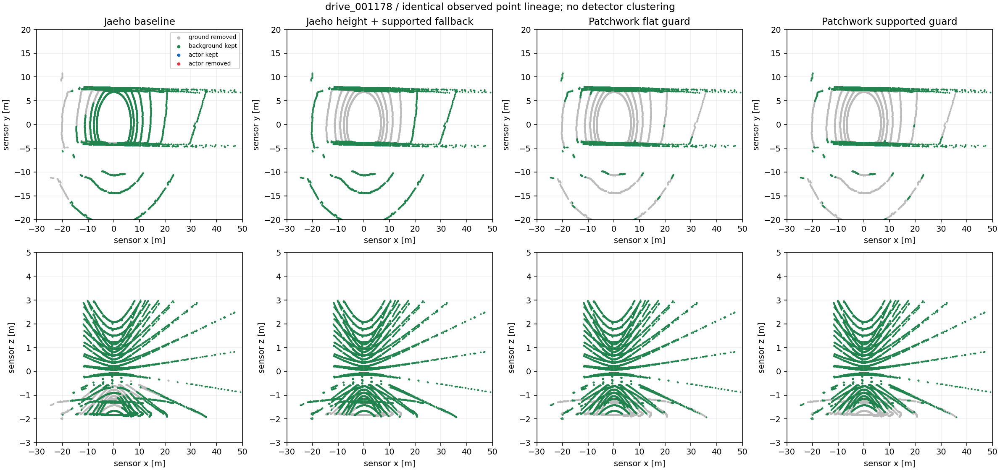
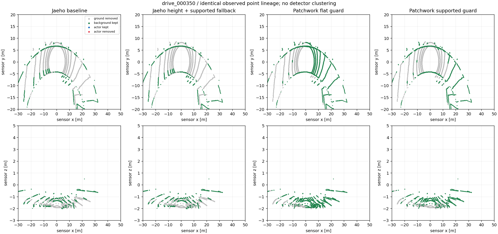
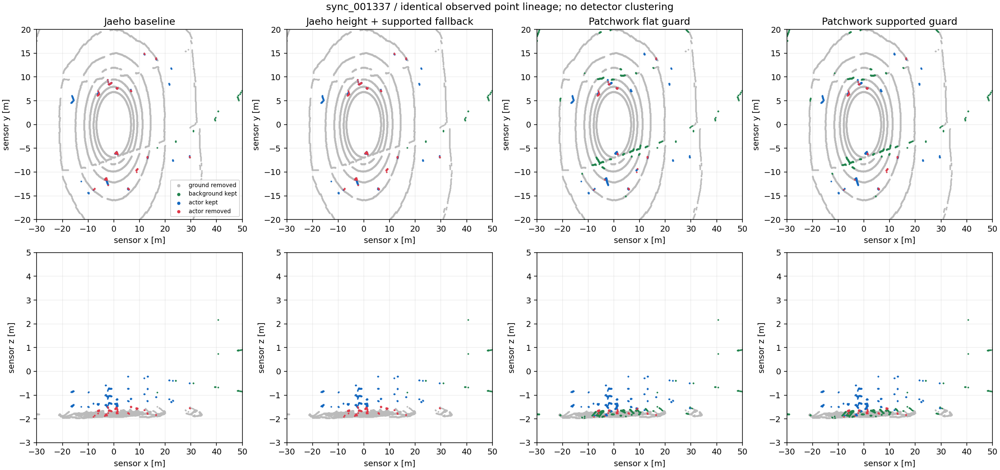

# L2-A2-V4 — 재호 터널 안정화와 Patchwork++ 경사 대응 비교

## 결정

**후속 구조물·군집 개발 기준은 재호의 높이 검증 + 동일 scan 제한 영역 보완
(`jaeho_support`)으로 선택한다. 운영 입력은 교체하지 않는다.**
Patchwork++의 이번 경사 대응 보호 규칙은 미채택이다. 기존 Patchwork++ 비교 경로는 보존한다.

이 선택은 **현재 재호 기준선에서 추가 회귀 없이 진행할 수 있는 변경**의 선택이지,
재호가 객체 보존까지 가장 좋다는 결론이 아니다. 기존 재호의 30cm 지면 거리 때문에
객체 하부가 삭제되는 한계는 남는다. 이미 삭제된 점을 후단 군집화가 복구할 수는 없다.
새 터널·램프 자료에는 객체 GT가 없으므로 보완 경로의 장애물 안전성을 승인하지 않는다.

- 작업 기준: `a0e2d25`, `feat/asmc-lidar-runtime`, 독립 worktree.
- 구현 커밋: `7898ffe`. 결과/안내는 별도 로컬 문서 커밋으로 관리한다.
- 원 구현 비교 기준: 손재호 `6435af1`. 동료 브랜치/운영 Main은 수정하지 않았다.
- 비교기의 “재호”는 **일반도로 RANSAC 지면 경로**다. 기존 전용 터널 필터는 이미
  높이·법선·시간 일관성 검사를 일부 갖고 있다. 이번 결과를 전체 Main 터널 코드의
  문제 해결이나 그 코드 전체와 Patchwork++의 비교라고 표현하지 않는다.
- 지면 마스크·구조물 삭제 마스크를 구분했다. 벽·천장 GT가 없는 semantic 종류를
  벽 정답으로 사용하지 않았다.
- 카메라, 군집, OBB, tracker, 판제, 센서/네트워크 설정 변경 없음. 푸시/PR 없음.

## 가설과 구현

공통 roll·pitch, ROI, 10cm voxel, 과거 IMU 선택, 원본점 계보를 유지했다.
[동결 실험 조건](../../../tools/lidar/ground_v4/EXPERIMENT.md)을 먼저 정하고 비교했다.

### 재호: 지면 평면의 높이를 검사하고, 탐색 실패를 별도로 보완

일반도로 원본은 기울기 `abs(nz)>=0.82`만 확인해 양의 높이 평면도 지면으로
채택할 수 있었다. 첫 후보 `jaeho_height`는 센서 원점의 평면 높이를
`[-2.25,-1.35]m`로 제한한다. 부적합 수평면은 **탐색에서만 제외하고 비지면으로
보존**한다. 원본의 3회 RANSAC, 30cm 거리, 수직면 제거 동작은 유지한다.

첫 후보는 잘못된 양의 높이를 없앴지만 터널 31프레임에서 세 번의 탐색이 끝나도
지면을 찾지 못했다. 이 결과를 보존한 뒤 두 번째 가설을 별도로 추가했다.

`jaeho_support`는 그 경우에만 **현재 scan**의 관측으로 제한된 근거리 평면을 찾는다.

- 반경 5~15m, z -2.9~-0.7m의 점; RANSAC 60회, 12cm.
- 지지점 30개/35% 이상, 기울기 15도 이하, 원점 높이 -2.10~-1.50m.
- 관측 폭 4×2m 이상, 중앙 잔차 8cm 이하.
- 적용 범위는 지지점 XY 범위 +2m와 반경 17m 이내의 교집합.
- 그 안에서만 기존 30cm 거리로 지면 판정. 기존 구조물 삭제점은 덮어쓰지 않는다.
- 범위 밖 점은 보존한다. 이전 프레임 평면을 자세 보정 없이 재사용하지 않는다.
- 평면 시도 번호 4와 `ground_anchor_used`, `ground_anchor_limited_domain`으로
  원본 3회 탐색 성공과 구분한다.

이는 자동 높이 추정기를 새로 만든 것이 아니다. 고정된 센서 높이 허용 범위가 있는
환경 한정 연구 후보이며, 언덕/차체 높이 변화와 장애물이 근거리 평면을 지배하는
경우는 추가 검증 대상이다.

### Patchwork++: 고정 수평 보호선 대신 관측된 경사 평면을 사용

기존 fixed 1.80m, RNR OFF, seed/patch/분할 설정은 유지했다.
평평한 `z>-1.55m` 보호 규칙은 경사 노면까지 되살리는 문제가 있어,
위와 같은 현재 scan 평면이 검증된 지원 영역에서만
`z > plane_height(x,y)+0.25m`로 바꿨다. 범위 밖/평면 실패에는 기존 보호를 유지한다.

**Patchwork++ 본체 개선이 아니라 환경 어댑터의 보호 규칙 비교**다.
GT로 평면을 선택하거나 장면별로 파라미터를 바꾸지 않았다.

## 입력과 재현

| 자료 | scan 수 | 용도 |
|---|---:|---|
| 기존 동기 | 1,439 | 객체·지면 GT 전수 |
| 기존 raw | 4,048 | 객체·지면 GT 전수 |
| 새 일반도로 | 361 | 도로 잔여/상태 |
| 새 터널 | 2,360 | 평면 선택/잔여 변화 |
| 새 횡경사 | 754 | 경사 대응 |
| 합계 | 8,962 | 독립 상황 수가 아닌 반복 관측 포함 |

새 세 주행의 객체 GT 관측은 0개다. “추가 객체 소실 0”의 근거는 기존 raw·동기만이다.
이미 분석한 자료이며 독립 시험 세트가 아니다. 지난 턴의 도로 밖 이탈 자료는
[V3 주행 manifest](../../../config/baselines/lidar_l2a2_v3_drive_20261005.yaml)의
제외 목록 그대로 유지했고 이번 비교에 넣지 않았다. 이번에는 시뮬레이터를 새로
주행시키지 않고 저장된 유효 입력을 재처리했다.

- 재호 보완안의 raw 4,048 + 동기 1,439 scan은 V3 대비 **점별 분류/구조물 마스크,
  원본점 계보, 관측 stamp가 정확히 동일**했다.
- 선택 재호 터널 2,360 / Patchwork 경사 754 scan을 재실행해 동일 항목을 정확히 확인했다.
- 새 바이너리의 기존 V3 경로도 경사 754 scan에서 이전 결과와 동일했다.
- Noetic 빌드와 CTest 6개 통과. Release에서도 시험 assert를 유지한다.
- 입력/라벨 파일 각각의 크기·SHA, 설정·소스·바이너리 SHA는 data closeout에 남겼다.
  최초 실행 manifest에는 공유 라이브러리 SHA가 빠져 있어 **최종 감사 해시**로 별도
  보완했다. 이를 최초 실행 시점부터 기록한 것처럼 취급하지 않는다.

## 결과 1: 재호 터널 안정화

| 터널 2,360 scan | V3 재호 | 높이 검사만 | 높이 + 지원 영역 보완 |
|---|---:|---:|---:|
| 양의 높이 평면 선택 | 8 | 0 | 0 |
| 인접 선택 높이 0.5m 초과 변화 | 82 | 0 | 0 |
| 지면 평면 미선택 | 1 | 31 | 0 |
| 아스팔트 잔여율, 점 가중 | 3.322% | 3.149% | 2.111% |
| 관측 잔여율 20%p 초과 변화 | 136 | 122 | 66 |

높이 비교는 같은 phase, 양의 시각 차 300ms 미만의 인접 scan이다. 잔여율 변화는
**관측 표면 자체의 변화를 포함한 진단**이지 운동 보상된 동일 노면의 깜빡임 정답이 아니다.
평면 높이 급변을 제거해도 삭제 마스크 변화는 남는다. “터널 튐 완전 해결”이라고 하지 않는다.

잔여율의 프레임 p99는 86.72%→39.60%, 인접 변화 p95는 34.79%p→7.92%p다.
재호 지원 평면은 터널 31회, 경사 9회 사용됐다. 경사 평면 높이 급변은 12→2회이고,
점 가중 아스팔트 잔여는 7.706%→7.214%다. 일반도로와 기존 raw/동기의 지원 평면 사용은 없다.



그림은 시각적 비교를 위해 원본 센서 XYZ를 사용한다. 실제 ROS 공개 점군은
수평화 역변환과 장착 변환을 거친 rear-axle base_link다. 녹색 배경점 전체가 벽은 아니다.

## 결과 2: Patchwork++ 경사 개선과 객체 회귀

| 항목 | 기존 수평 보호 | 지원 평면 보호 |
|---|---:|---:|
| 횡경사 아스팔트 잔여율 | 41.572% | 9.115% |
| 터널 아스팔트 잔여율 | 3.112% | 2.355% |
| 동기 장애물 완전 소실 | 25/870관측 | 27/870관측 |
| raw 장애물 완전 소실 | 6/577관측 | 7/577관측 |

경사 잔여는 상대 78.08% 감소했지만, **원래 남았던 장애물 3관측을 완전히 삭제**했다.

| 입력 | instance | 관측점 | 기존 남은 점 → 후보 |
|---|---:|---:|---:|
| sync_001312 | 6 | 14 | 3→0 |
| sync_001337 | 7 | 12 | 10→0 |
| raw_003767 | 2 | 15 | 1→0 |

서로 다른 실세계 장애물 3개라는 뜻은 아니다. 10점 이상 관측 조건을 만족하므로
미리 정한 추가 완전 소실 0건 조건에 실패한다. 기존 군집 최소점 기준을 끌어와
이 실패를 제외하지 않았다.

동기 차량 전체/하부 보존은 98.252/93.471%→98.234/93.401%,
보행자는 92.740/74.761%→92.711/74.659%로 소폭 하락했다.
장애물 클래스 평균이 좋아져도 개별 완전 소실을 감추지 않는다.





전체 장면 그림만으로 작은 장애물 소실을 판독하기 어렵다. 개별 수치는
`*_support_score/frames.jsonl.gz`와 위 instance/원본점 대응으로 확인한다.

### 재호가 객체 보존까지 가장 좋다는 결론은 아니다

동기 10점 이상 관측에서 재호 보완안의 차량/보행자/장애물 하부 보존율은
각각 **77.05 / 39.29 / 28.51%**, 기존 Patchwork++는
**93.47 / 74.76 / 63.74%**다. 재호 장애물 완전 소실은 동기 88/870,
raw 26/577로 이번 보완 전후 동일하다. 시각적으로 깔끔하다는 이유로 이 손실을
정상 처리라고 승인하지 않는다.

이번 재호 선택은 자기 기준선의 점별 결과를 악화시키지 않고 잘못된 평면 선택을
줄였기 때문이다. 기존 Patchwork++의 객체 보존 장점을 포기하거나 모든 상황에서
재호가 우세하다고 정한 것이 아니다.

## 잔여 구조와 비용

배경 연결 지표는 **매 20번째 scan**을 같은 위치에서 표본화했다. 객체 지표는 전수다.
0.2/0.4/0.8m 전체 결과는 summary에 보존했다. 0.4m 아스팔트 진단 예:

| 구간/방법 | 추가 분절, 전→후 | 새 고립점, 전→후 |
|---|---:|---:|
| 터널 재호 | 264→270 | 68→68 |
| 경사 재호 | 3→3 | 2→2 |
| 터널 Patchwork++ | 189→182 | 69→69 |
| 경사 Patchwork++ | 30→58 | 21→31 |

Patchwork++는 경사 잔여 총량은 크게 줄여도 작은 조각은 늘었다.
재호 역시 터널 분절이 모두 개선된 것은 아니다. 잔여 총량 감소를 후단 처리 용이성이나
객체 분리 성능으로 자동 환산하지 않는다.

독립 master 11431에서 실제 터널 bag의 IMU+LiDAR만 1.4배로 재생했다.
방법별 31초 단독 실행이며 실제 관측 입력은 약 14.63Hz, 내부 queue drop은 모두 0이었다.

| 방법 | 계산 p50/p95/p99 ms | 수신→발행 p50/p95/p99 ms |
|---|---|---|
| 재호 V3 | 16.32 / 26.65 / 33.76 | 17.01 / 27.29 / 34.43 |
| 재호 보완 | 16.37 / 19.00 / 28.07 | 17.05 / 19.70 / 30.11 |
| Patchwork 보완 | 14.85 / 16.11 / 23.96 | 15.45 / 16.73 / 24.63 |

각 시험에 IMU stale 1건, 시작/끝 sensor_missing 상태 2~5건이 있었다.
정상 빈 입력으로 숨기지 않았다. 계산에는 공통 준비가 포함된다.
별도 CPU/GPU 부하 통제나 전체 판제·YOLO 동시 실행이 아니며,
단 한 회의 replay로 항상 더 빠르다고 결론 내리지 않는다.
이전 실제 주행의 약 10Hz 입력이 15Hz였다는 증거도 아니다.

## 재실행·실시간 확인·되돌리기

[실험 도구 안내](../../../tools/lidar/ground_v4/README.md),
[고정 manifest](../../../config/baselines/lidar_l2a2_v4_20261005.yaml)를 본다.

컨테이너 안에서 기존 bridge를 그대로 사용한다. 기존 비교 노드는 먼저 Ctrl-C:

```bash
source /opt/ros/noetic/setup.bash
source /root/ws/devel/setup.bash
roslaunch asmc_lidar ground_compare_live.launch method:=jaeho \
  comparison_config:=/root/ws/src/asmc_lidar/config/ground_v4/jaeho_support.yaml
```

Patchwork 연구 후보는 `method:=patchwork`,
설정 `ground_v4/patchwork_support.yaml`로 교체한다. 두 명령을 같은 master에서
동시에 켜지 않는다. RViz의 Jaeho/Patchwork 그룹과 Ground plane fits를 토글한다.
상태의 config_id와 ground_anchor_used를 확인한다. 새 지면 후보 역시 장애물 검출 결과가 아니다.

되돌리기는 노드를 종료한 뒤 `ground_v3/roll_pitch_all.yaml`로 시작하면 된다.
config 미지정 기본 V1도 그대로 유지했다. 운영 Main/판제에는 애초에 연결하지 않았으므로
운영 입력 복구 작업은 없다.

## 다음 경계

지면 파라미터 탐색은 여기서 멈춘다. 사용자 시각 검토 후 선택 입력을 고정해
구조물·군집의 분할/합침을 독립 비교할 수 있다. 다만 **지면 단계에서 이미 없어진
객체와 군집 실패를 별도 분모로 기록**한다.

운영 승격 전에는 이번 fallback이 실제 사용되는 터널/경사에서 차량·보행자·낮은 장애물을
배치한 GT 검증이 필요하다. 낮은 객체 삭제를 tracker나 군집 파라미터로 숨기지 않는다.
추가 객체 소실, 높이 허용 범위를 벗어난 노면, stale 입력 오사용이 확인되면
후보 승격을 취소한다. 이번 결과로 운영 승인이나 전 미션 성공을 선언하지 않는다.
