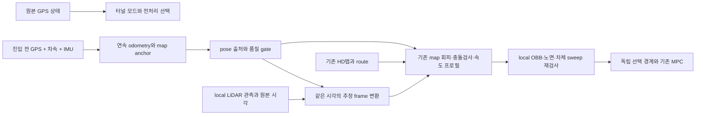

# AIMDrive 측위를 이용한 음영구간 map 판제 재사용 분석

2026-10-28. **GPS 진입점에 연결한 DR 위치로 기존 map 기반 정적 회피 코어를
재사용하는 방향은 가능성이 있다.** 다만 위치 토픽 하나를 대체하는 것으로 연결되지는 않는다.
실제 GPS 무효 상태, 추정 위치의 품질, 객체의 좌표·속도, 제어 생산자 선택을 분리해야 한다.
우선 정적 기하·충돌 검사·속도 프로필·MPC를 재사용하고, 동적 예측은 추정 속도의 품질을
확인한 뒤 연결하는 단계가 적합하다. 아래는 설계 분석이며 운영 구현이나 주행 수락이 아니다.

## 분기와 다른 작업의 경계

- 분기: `feat/shadow-local-footprint`의 커밋 `6f416d466bc316a147b92c6da903c54f1bdf0071`.
- 분석 브랜치: `research/shadow-aimdrive-localization-20261028`, 별도 `2026-ASMC-aimdrive` worktree.
- 기존 work의 미커밋 local 처리 변경은 분기에 옮기지 않았다. 해당 작업의 최신 결과와 본 분석의
  고정 기준선을 혼동하지 않는다. 기존 main의 detached checkout과 미커밋 mirror도 유지한다.
- `fix/pr127-shadow-integration`의 index·미커밋 변경·CI 통합 작업은 건드리지 않는다.
- 이 브랜치에서는 소스 참조와 순수 수치 검사만 수행했다. ROS·UDP·시뮬레이터 연결,
  노드 재시작·새 bag/학습·주행·기존 build/overlay 교체는 하지 않았다.

## 확인한 AIMDrive 정본

원격 main은 `730eb8a4a2306ea1b5044ea741fcf308ae986795`다. 공유 external의 기존
checkout `1606844179d0528c673e7a81a7820a980e2372bb`는 갱신하지 않았다.
분석한 Localization·UDP·Expert 관련 **36개 파일의 Git blob이 두 revision에서 모두 동일**해
기존 checkout의 원본을 읽었다. [파일별 고정 근거와 검사 결과](2026-10-28-aimdrive-shadow-map-analysis.json)를 남긴다.

| 원본 | 실제 역할 |
|---|---|
| [gps_aligned_hold.py](https://github.com/INHA-AIM/AIMDrive/blob/730eb8a4a2306ea1b5044ea741fcf308ae986795/AIM2026/Localization/gps_aligned_hold.py) | signed speed와 IMU 자세의 연속 적분, motion-compensated GPS offset, 복귀 smoothing |
| [gps_blackout_hold.py](https://github.com/INHA-AIM/AIMDrive/blob/730eb8a4a2306ea1b5044ea741fcf308ae986795/AIM2026/Localization/gps_blackout_hold.py) | GPS 소실·입력 age·시간/거리 한계·위치 제공 거부 |
| [service.py](https://github.com/INHA-AIM/AIMDrive/blob/730eb8a4a2306ea1b5044ea741fcf308ae986795/AIM2026/Localization/service.py) · [adapters.py](https://github.com/INHA-AIM/AIMDrive/blob/730eb8a4a2306ea1b5044ea741fcf308ae986795/AIM2026/Localization/adapters.py) | 공유 수신부 위의 위치 서비스, epoch/식별자, 허용 필드 선택 |
| [UDP/Manager.py](https://github.com/INHA-AIM/AIMDrive/blob/730eb8a4a2306ea1b5044ea741fcf308ae986795/AIM2026/UDP/Manager.py) · [UDP/Pose.py](https://github.com/INHA-AIM/AIMDrive/blob/730eb8a4a2306ea1b5044ea741fcf308ae986795/AIM2026/UDP/Pose.py) | LocalizationService 연결과 GPS/DR 위치 출처 표시 |
| [Expert/runtime.py](https://github.com/INHA-AIM/AIMDrive/blob/730eb8a4a2306ea1b5044ea741fcf308ae986795/AIM2026/Expert/runtime.py) | 기능 활성 시 `GPS_dead_reckoning` 출처를 명시적으로 허용하고 기존 Expert에 전달 |
| [jamming/recorded_planner.py](https://github.com/INHA-AIM/AIMDrive/blob/730eb8a4a2306ea1b5044ea741fcf308ae986795/AIM2026/Expert/src/planning/jamming/recorded_planner.py) · [corridor.py](https://github.com/INHA-AIM/AIMDrive/blob/730eb8a4a2306ea1b5044ea741fcf308ae986795/AIM2026/Expert/src/planning/jamming/corridor.py) | 자차·장애물·경로를 함께 구간 좌표로 변환하고 기존 정적 회피 코어 재사용 |

`AIM2026/GPSJamming`은 현재 벽 경계 검출 모듈이며, 측위 구현의 정본은
`AIM2026/Localization`이다. GPSJamming README의 과거 연결 설명과 실제
UDP/Manager의 LocalizationService 연결을 구분했다. VE 모델이나 Expert 전체가 DR의 필수 의존성은 아니다.

## 측위가 실제로 하는 일

1. **정상 GPS:** 차속과 quaternion에서 구한 body-forward 방향을 적분해 연속 odometry를 만든다.
   이미 도착한 IMU 표본에서 source 시각 보간 또는 최대 50ms gyro 전파를 사용한다.
   source 시각이 없으면 receipt-causal 방식으로 내려가고 그 사실을 표시한다.
2. UTM52N의 meridian convergence를 적용해 true ENU 방향과 projected-grid 축을 맞춘다.
   부호 있는 차속을 사용하므로 후진도 적분한다. body-forward의 XY 성분에는 pitch 효과도 들어간다.
3. 최근 기본 1초 GPS에 대해 `GPS 위치 - 같은 시각의 odometry 위치`를 평균해 offset을 만든다.
   이동 중 GPS 좌표 자체를 평균하여 생기는 단순 위치 지연과 구분한다.
4. **GPS 무효:** 마지막 offset을 고정하고 `p_map = p_odom + offset`으로 위치를 계속 제공한다.
   터널 내부 GPS, GT 자차 position/heading, 벽 또는 차선의 map matching은 이 추정기의 보정 입력이 아니다.
5. **GPS 복구:** 정상 모드에서는 offset을 시간상수 0.7초로 따라가고, 차이가 0.5m보다 크면
   0.15초로 빠르게 따라간다. 이 숫자는 우리 차량의 검증된 설정이 아니다.
6. 기본 최대 120초·250m와 status/IMU 공백 조건을 넘으면 위치를 제공하지 않는다.
   이는 허용 동작 범위이며 120초 또는 250m의 위치 정확도를 보장하는 수치가 아니다.

GPS가 정상일 때는 smoothed offset, DR 갱신에서는 마지막 window offset을 사용하므로
진입 시 미반영 offset이 남은 경우의 위치 연속성도 따로 검사해야 한다. 복귀 smoothing은
소스에서 확인했지만 이번 분석에서 전체 LocalizationService의 진입·복귀 성능을 재시험하지 않았다.

## 우리 코드와 맞는 점과 바로 가져올 수 없는 점

**지도는 잘 맞는다.** AIM의 map origin은 우리와 같은 `[302595.0, 4124145.0, 0.0]`이고
UTM52N을 사용한다. 우리 HD맵 A126 중심선은 약 118.99m이며 시작/끝 XY는
`[29.5894,-487.6503]` / `[-74.8607,-544.578]`다. AIM의 시험 blackout 직사각형 끝점과
반올림 범위에서 일치한다. A131 반대 차로도 우리 주행가능영역에 명시적으로 들어 있다.
다만 AIM의 blackout 직사각형은 개발 시험용이고 실제 대회 GPS 경계를 입증하지 않는다.

| 항목 | 이식 시 조건 |
|---|---|
| 센서 기준점 | AIM aligned hold는 GPS 위치와 IMU 회전 장착값이 0인 구성을 요구한다. 우리 GPS의 후륜축 대비 x=0.35m lever를 먼저 보정해야 한다. 센서셋을 0으로 바꿔 맞추지 않는다. |
| 속도 단위 | AIM MotionTrack 입력은 signed km/h 후 `/3.6`이다. 우리 local node는 `/Ego_topic.velocity.x`를 m/s로 소비한다. adapter에서 단위를 한 번만 바꾼다. |
| GPS 주기 | AIM의 fresh GPS 상수는 0.15초다. 우리 5Hz GPS에 그대로 쓰면 정상 주기 사이에도 DR 모드로 바뀔 수 있어, 기존 GPS 유효성·주기와 분리해 검증한다. |
| 시각 | source↔source가 입증된 경우만 적분·정렬한다. 현재 ROS header의 receive 성격을 raw 센서 acquisition 시각으로 승격하지 않는다. GPS anchor의 수신 정렬도 지연 근사임을 유지한다. |
| 입력 검사 | 기존 IMU yaw jump·CAN·epoch/역행 검사를 유지한다. AIM의 finite/간격 검사로 기존 거부를 완화하지 않는다. |
| 허용 입력 | 자차 GT position/heading, Object/Detail 채널을 측위 입력으로 추가하지 않는다. 기존 bridge가 제공하는 차속·IMU·진입 전 GPS를 사용한다. |

기존 [짧은 DR 대조](2026-10-28-local-timing-and-dr-pilot.md)는 이미 AIM의 MotionTrack과
현재 C++ 상대 적분을 비교했다. 35.07m 기록의 상대 2D 오차 p95는 각각 약 21.50/21.34cm,
18m대 기록들은 약 5–8cm였다. 첫 평가 위치 정렬과 별도 GPS-anchor 검사의 범위가 다르므로
이를 119m 전체의 GPS-anchored 성적으로 합치지 않는다. 기존 코어를 교체하기보다 그 위에
전역 anchor·출처·품질 계약을 얹는 방안이 우선이다.

## 반드시 나눠야 하는 현재 연결

| 현재 코드의 연결 | 필요한 분리 |
|---|---|
| [pipeline.cpp](../../../src/asmc_lidar/src/pipeline/pipeline.cpp)의 `TunnelRoute::Select(map_pose.valid)` | 실제 GPS의 무효는 터널 전처리를 계속 켜고, DR 기반 map 변환 가능 여부는 별도 값으로 둔다. DR pose를 map valid로 넣어 벽/천장 제거를 끄지 않는다. |
| [typed_output.cpp](../../../src/asmc_lidar/src/ros/typed_output.cpp) · [planning_output.hpp](../../../src/asmc_lidar/include/asmc_lidar/ros/planning_output.hpp) | GPS 무효 때 정본 map 배열은 의도적으로 비운다. local 관측을 같은 시각의 추정 pose로 변환하는 별도 연구 adapter가 필요하다. |
| [GpsModeSource](../../../src/asmc_planner/src/Planning/GpsModeSource.cpp) · [ControlSelector](../../../src/asmc_planner/src/Planning/ControlSelector.cpp) | raw GPS가 무효면 기존 NORMAL 명령은 선택되지 않는다. 가짜 GPS로 우회하지 않고 연구용 제어 선택 경계를 따로 둔다. |
| [planning_inputs converter](../../../src/planning_inputs/src/converter.cpp) | 기존 global 변환은 `map`을 요구한다. `shadow_map`을 이름만 map으로 바꾸지 말고, 지도와 정렬한 추정 frame의 품질·소유권을 확인한 전용 경계에서 기존 core 입력으로 변환한다. |
| [dynamic_behavior 설정](../../../src/asmc_planner/config/behavior/behavior_params.yaml) | 현재 동적 정책 scope는 A728/A599/A207/A205이며 A126이 없다. 터널 실험 설정에서 적용 구간과 반대 차로 정책을 별도 검증한다. |
| LiDAR의 map 운동 이력·절대속도 validity | 추정 위치를 얻었다고 객체 속도가 유효해지는 것은 아니다. 동일 ego trajectory·scan 시각으로 보상하고 불확실성·재anchor 경계를 반영한다. |

## 제안: GPS-anchored shadow-map + 기존 map 판제 + local 검증

이 그림은 연결 설계다. 이번 브랜치에서 ROS producer나 제어 경로로 구현하지 않았다.

- **측위 상태:** GPS_VALID → DR_ACTIVE → REACQUIRING, 그리고 별도 UNAVAILABLE.
  raw GPS validity는 그대로 두고 source stamp, anchor ID/age, hold 시간/거리,
  위치·방향 오차 한계 또는 covariance, reset/reanchor epoch를 독립적으로 제공한다.
  이 품질 계약은 추가 설계 항목이며 AIM 원본이 검증된 covariance를 제공한다는 뜻은 아니다.
  새 IMU가 왔다고 GPS anchor가 새로 관측된 것처럼 표시하지 않는다.
- **객체:** 기존 local OBB의 8코너·ID·원본 시각을 유지하고 관측 시각의 pose로 변환한다.
  제어 시각까지의 물체 예측은 별도 단계다. `OBSERVED_EMPTY`, 미관측, pose 무효를 구분한다.
- **정적 우선:** [MapAvoid](../../../src/asmc_planner/src/Frenet/Maneuver/Avoid/MapAvoid.cpp)의
  SHIFT/PASS/RETURN·재연결, [CollisionChecker](../../../src/asmc_planner/src/Frenet/Evaluation/CollisionChecker.cpp),
  [SpeedProfiler](../../../src/asmc_planner/src/Frenet/Speed/SpeedProfiler.cpp), 기존 MPC를 재사용한다.
  map route를 장거리 참조로 쓰되 현재 local OBB·관측 노면의 차체 검증을 우선 조건으로 둔다.
- **연결 지점:** `MapAvoidProcess`는 독립 함수가 아니라 `FrenetPlanner`의 private 구현이다.
  [공개 `Init`/`Plan` 경계](../../../src/asmc_planner/src/Frenet/frenet_planner.hpp)와
  행동 명령·실행 상태를 연구 adapter에서 연결하는 것이 우선 후보이며,
  장애물 목록만 넘기면 기존 회피 FSM까지 자동 연결된다고 가정하지 않는다.
  선택한 map 경로는 동일 anchor/epoch의 연속 local frame으로 역변환하고
  [LocalTrajectory](../../../src/asmc_msgs/msg/LocalTrajectory.msg)의 시각·`ego_at_plan`·`dt` 계약을
  만족시켜 기존 local MPC에 전달하는 방안이 적합하다. 지도 재anchor는 local odometry를
  순간 이동시키지 않아야 한다. 단순 frame 이름 변경으로 연결하지 않는다.
- **동적 단계:** [DynamicObjectPolicy](../../../src/asmc_planner/src/Behavior/Feature/DynamicObjectPolicy.cpp)의
  점유·정지·추종 판단부터 재사용한다. 속도 미확정 객체를 정지 물체로 승격하지 않는다.
  지도 위치 차분의 자차 오차가 가짜 객체 속도가 되므로, 절대속도/운동 상태와 예측 기반 회피는
  ego 보상·불확실성·터널 scope 시험 뒤에 연결한다. 기존 분류 보존과 동적 정확도 수락은 별개다.
- **출구 복귀:** 기존 RETURN 코어에 `남은 route 거리 > 복귀 거리 + 정지 거리 + 종방향 오차 여유`
  조건을 검토할 수 있다. 복귀 실패 때 출구 전에 강제로 차로를 바꾸지 않는다.
  GPS 복구만으로 pose·객체 epoch·MPC 참조를 다른 프레임으로 순간 교체하지 않는다.

현재 LOCAL-1은 이미 공용 footprint·속도 프로필·MPC를 일부 재사용한다. 그 입력 정렬과 local
검증을 유지하면서 상위 map 참조를 추가하는 방안이다. 본차로 중심은 복귀용 soft reference이고,
양 차로의 물리적 주행가능영역과 구분한다. 지도에서 오른쪽 차로에 pose를 맞추기 위해 실제
회피 이동을 지워서는 안 된다.

운영 planner를 하나 더 띄우는 방식은 피한다.
[planner_v2.launch](../../../src/asmc_planner/launch/planner_v2.launch)는
`/behavior_planner/topics/ego` 등 절대 경로 파라미터를 쓰므로 namespace만 바꿔도 기존 실행과
충돌할 수 있다. 후속 실험은 계산 코어를 호출하는 독립 adapter와 전용 입출력·파라미터를
사용하고, 제어에 연결할 때도 하나의 선택 경계를 거친다. 이번에는 launch를 실행하지 않았다.

## DR 오차와 보조 관측의 범위

아래는 실측 성능이 아닌 일정한 바이어스를 가정한 감도 계산이다.

| 조건 | 누적 위치 차이 |
|---|---:|
| 120m, 방향 오차 0.1° | 횡방향 약 0.21m |
| 120m, 방향 오차 0.5° | 횡방향 약 1.05m |
| 120m, 방향 오차 1° | 횡방향 약 2.09m |
| 120m, 차속 scale 오차 1% | 진행방향 약 1.20m |
| 25km/h, 시각 불일치 185ms | 이동거리 약 1.28m |

기존 map 전달 필터의 안쪽 10cm 기준을 DR pose에서도 그대로 정확한 경계로 취급할 수 없다.
지도 밖이라는 이유로 실제 local 객체를 지우지 않고 pose 오차만큼 경계/충돌 여유를 평가한다.
map 기반 위치는 모르는 근거리 공간을 free로 만들거나 가짜 OBB의 진위를 해결하지 않는다.

장거리 DR 품질이 부족하면 현재 관측의 차선 역할·벽 방향을 이용해 **횡위치와 방향만**
완만하게 보정하는 후속 후보가 있다. 진입 anchor·차선 역할·시간적 연속성으로 대응을 제한하고,
가려진 벽이나 실제 차량 측면을 기준으로 pose를 끌어당기지 않는다. 평행한 터널 벽만으로는
진행방향 위치가 충분히 관측되지 않으므로 종방향 DR 오차를 따로 유지해야 한다.
이 보조 보정은 AIMDrive 원본에 이미 있는 기능이라고 주장하지 않는다.

## 독립 검증 순서

| 단계 | 작업과 통과 근거 |
|---|---|
| A0 · 이번 분석 | 고정 소스/지도/입력 계약 대조. 원본 MotionTrack 순수 수치 검사 7개 통과. 제어 없음. |
| A1 · 다음 구현 | private anchor/odometry/quality adapter만 구현. 후진·yaw wrap·epoch·stale·진입 중 시작(no anchor)·lever·단위 시험. |
| A2 | 먼저 기존 기록에 진입 전 유효 GPS anchor와 A126 전체·회피·감가속·복귀가 있는지 확인한다. 확보된 범위에서 가상 GPS blackout으로 LOCAL-1·현재 DR·AIM식 anchor를 동일 입력/시각으로 대조한다. 없는 구간을 검증했다고 하지 않으며 GT는 독립 평가에만 사용한다. |
| A3 | 동일 local OBB로 map 정적 회피와 local 검증을 폐루프 없이 비교. pose 오차 주입, 벽 인접 실물 보존, 가짜/거대 OBB를 포함. |
| A4 | 동적 객체 속도·TTC·횡단·맞은편·시각 공백·소실/재등장. 정상 구간의 동적 정책 수락과 별도로 판단. |
| A5 | 별도 승인한 한 제어 생산자의 저속 실험. 진입/출구와 GPS 복귀 전후 경로·정지·복귀를 검증한 뒤 범위 확대. |

판단 기준은 단순 DR 위치 오차 평균보다 **남은 차체 여유, 오차 한계, 실제 local 장애물,
관측/제어 지연, 정지 가능 거리**다. 기록을 넘어서는 정확도를 추정값으로 보장하지 않는다.
새 bag 재생·실험 출력이 필요하면 workspace 저장 규약에 따라 D에 새 run을 등록한다.

이번에 직접 실행한 7개 검사는 전진·후진·90° 방향·grid convergence·pitch 투영·
receipt jitter 아래 source-time 거리 보존·과도한 source 간격의 거부다. full service,
119m 기록 재생, map planner 또는 차량 제어의 새 검증 결과는 아니다.

## 결론과 구현 범위

첫 구현 후보는 **현재 상대 적분 위에 AIM식 GPS anchor/출처·품질 계약을 추가하고,
기존 map 정적 회피 코어를 local 검증과 함께 사용하는 독립 경로**다. 순수 DR만으로 기존
정상 주행 스택을 통째로 NORMAL 모드에 연결하는 방식은 채택 근거가 부족하다.
동적 정책은 기하와 보수적 점유 응답을 먼저 재사용하고 예측·회피는 별도 수락한다.
현재 두 작업의 변경을 합치거나 기본 실행을 교체하지 않은 상태에서 이 분기로 검증할 수 있다.

AIMDrive 소스는 참조로 읽고 원본 MotionTrack을 수치 검사에서 직접 불러왔다.
외부 코드를 이 저장소에 복사하거나 런타임 의존성으로 추가하지 않았다.

후속: [정적 map 회피 이식과 검사 결과](2026-10-28-aimdrive-shadow-static-port.md).
