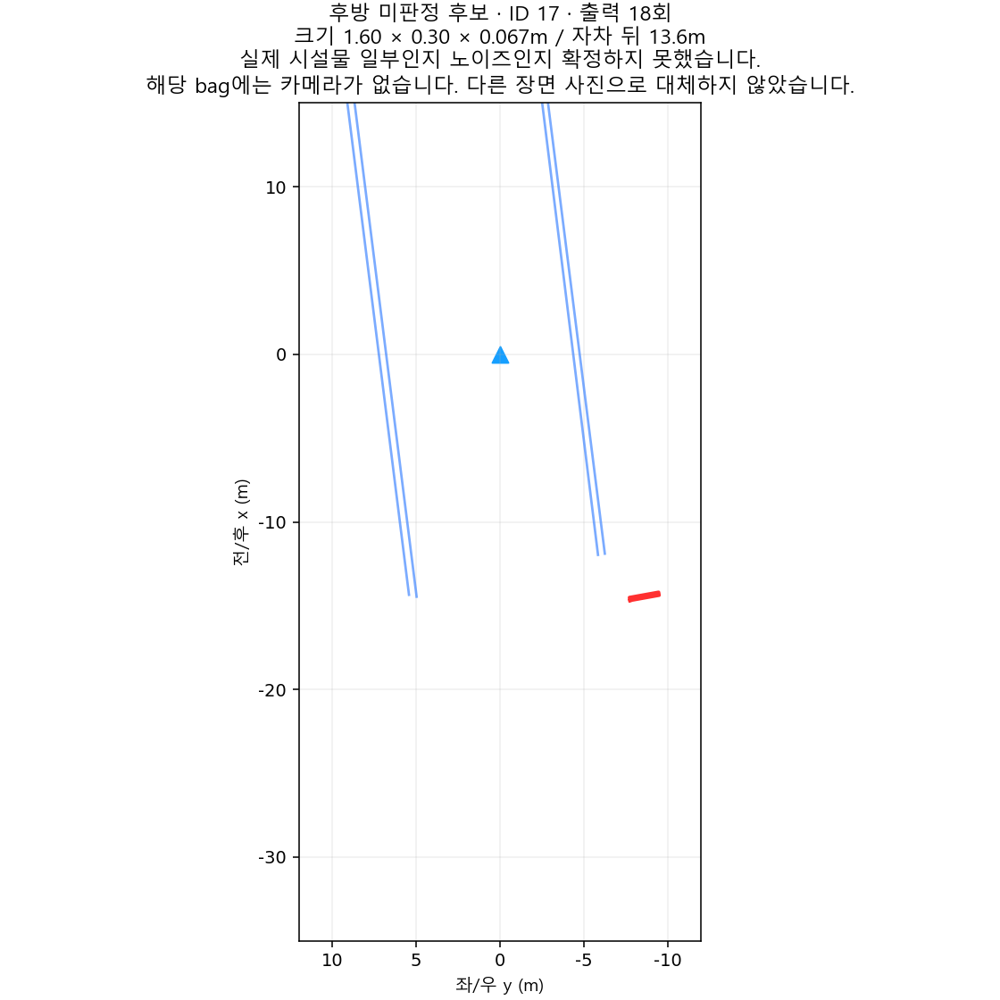
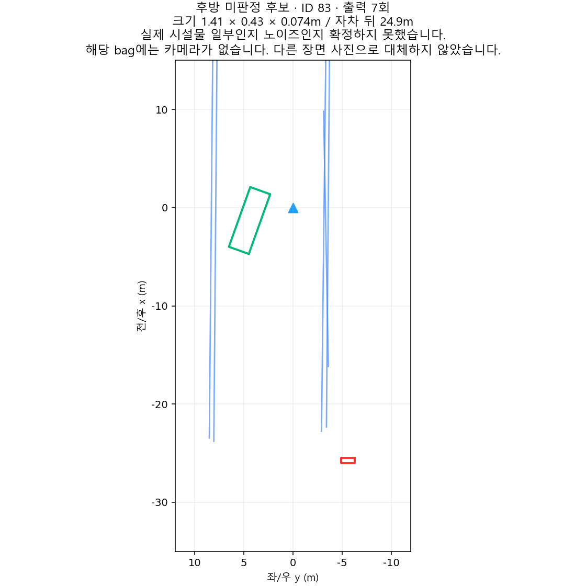

# GPS 음영구간 LiDAR 전처리 통합

## 동작

이 PR은 main의 `asmc_lidar`에 GPS 상태에 따른 자동 전처리 분기를 추가한다. 별도의 터널 진입 버튼은 필요 없다.

| 입력 상태 | 전처리 | 출력 |
|---|---|---|
| 유효 GPS 수신 | 기존 main 경로 | `base_link` 로컬 + `map` 글로벌 |
| 위도·경도가 0이거나 GPS 상태가 무효 | 음영구간 전처리 | 유효 로컬만 제공 |
| GPS 입력 중단 또는 시작부터 없음 | 기존 최대 0.3초 유효시간 만료 후 음영구간 전처리 | 유효 로컬만 제공 |
| GPS 정상 복구 | 기존 회복 조건인 정상 샘플 3회 확인 후 main 경로 | 로컬 + 글로벌 복구 |

0이라는 조건은 GPS 위도·경도에 대한 조건이다. 정상 지도 원점에서 로컬/글로벌 x 또는 y가 0인 것은 음영 판정 조건이 아니다. 단순 수신 여부 외에도 기존 GPS sanity·시간 유효성 검사를 통과해야 한다. IMU/CAN/LiDAR 자체가 무효이면 기존 입력 오류 처리를 유지한다.

GPS 무효일 때 글로벌 토픽을 마지막 좌표로 유지하지 않는다. 기존 인터페이스대로 **객체가 비어 있는 `POSE_UNAVAILABLE` 메시지**를 보내 오래된 글로벌 장애물이 남지 않게 한다. 따라서 '로컬만 제공'은 사용 가능한 글로벌 객체 좌표를 제공하지 않는다는 뜻이다. 로컬 프레임은 `base_link`, 글로벌 프레임은 `map`이다.

## 음영구간에만 적용되는 내용

1. 중력 정렬 후 지면·천장·벽 평면을 추정하고 실제 점을 제거한다.
2. 벽 추적은 스캔 시각의 IMU yaw와 부호가 있는 CAN 전·후진 속도를 반영한다. 오래된 벽을 회전 전 위치에 그대로 적용하지 않는다.
3. 벽·지면 조각의 형태, 현재 벽의 유효 구간, 실제 점 지지를 함께 검사한다. 벽 뒤쪽의 낮고 평평한 연결 조각도 조건을 만족하면 제거한다.
4. 센서 좌표 기준 군집 평균 z가 -1.30m보다 낮은 후보를 제거한다.
5. 남은 후보는 일반 3회 관측, 벽·지면 조각형 5회 관측, 특정 넓고 낮은 조각형 6회 관측으로 구분한다. 예측만 된 프레임은 관측 횟수에 포함하지 않는다. 유효 카메라 객체 근거가 있는 후보는 보호한다. 카메라가 없으면 LiDAR 근거로 처리한다.
6. 출력 보류 시 OBB와 해당 후보의 실제 점 지지를 함께 제외한다. 추적 내부 상태는 보존하여 관측 횟수를 누적한다.

필터는 GPS 음영을 판정한 때만 동작한다. GPS 정상 상태에서는 기존 높이 제한·지면 제거·군집화 경로를 사용한다. 과거 실험의 GPS 정상 상태 입구 천장/거대 OBB 제거는 적용하지 않는다. 일반 구간의 군집 파라미터 및 웹 튜닝 기능은 이 PR에 옮기지 않는다.

주요 설정: `config/lidar_pipeline.yaml` → `experimental.tunnel_filter`. 기본값은 자동 적용 ON이다. 벽 평면 적합 거리 0.15m, 벽 제거 거리 0.25m, 벽 추적 오프셋 0.60m, 음영구간 군집 거리 1.0m·최소 10점이다. 이는 각각 다른 역할의 거리이며 '벽 두께' 하나로 취급하지 않는다. 기존 launch의 명시적 `experimental_tunnel_filter:=false`는 기본 설정을 덮어쓰므로 자동 적용하려면 제거하거나 true로 설정한다.

## 검증 결과와 한계 — 2026-10-27

기준 main: `936663152de770795edd925e11c115d84b8dfb00`.

- ROS/PCL 네이티브 빌드 성공, CTest **40/40 통과**. GPS 무수신·0좌표·수신 중단·정상 복구 시험을 추가했다. 실제 MORAI나 Docker를 실행하지 않았다.
- 대상 주행 기록 17개를 자동 기본 설정으로 재처리하고, 같은 기록의 필터 OFF 대조 17회 및 GPS 강제 무효 스트레스 13회를 실행했다. 총 **47회 실행 모두 성공**.
- 실제 입력 6,408프레임 중 6,395프레임 처리. 입력 오류 13프레임은 대조 실행과 동일하다. 순수 정지 기록은 이 주행 평가에서 제외했다.
- 정상 GPS **4,230프레임 모두** 필터 OFF 대조와 전처리 점군 digest가 동일하다. 음영구간과 초기 GPS 대기 포함 2,165프레임 및 강제 음영 2,965프레임은 이전 최종 검증의 필터 후 점군과 동일하다.
- 알려진 낮은 조각의 기존 8회 관측과 스트레스 벽 조각의 기존 12회 관측에서 해당 잔여 출력은 0회다.
- 입·출구 시설물의 기존 97회 출력은 위치 기준 97회 모두 보존했다. 7점만 관측된 시설물 2장면도 형상·점 수가 동일하다. 기존 차량의 **음영구간 출력 138회는 138회 모두** 위치 기준 보존했다.

정상 경로 전처리가 같다는 것이 전체 추적 메시지의 비트 단위 동일성을 의미하지 않는다. 음영구간의 검출 이력이 달라져 추적 ID·속도·동적 판정 이력이 달라질 수 있다. 정상 GPS 전체 typed 메시지는 ID와 검출 순서를 제외해도 3,923/4,230프레임이 정확히 같다. 기존 실험 브랜치의 일반 구간 군집 파라미터도 main과 달랐으므로 그 실험 결과 전체와 동일하다고 주장하지 않는다. 차량의 과거 전체 출력 141회 중 정상 GPS 3회는 main의 더 작은 군집 거리에서 분할되어 위치 1m 매칭 기준을 만족하지 않았으며, 음영 필터로 지워진 경우가 아니다.

### 실제 기록에서 남은 후보

**감사한 실제 음영구간에서 남은 형태 후보는 후방 2개이며 전방에 걸친 OBB는 0개**다. 모든 물체의 정답 라벨이 있는 것은 아니므로 모든 환경에서 노이즈가 0이라고 보장하지 않는다.

| 후보 ID(재생별 진단 ID) | 출력 횟수 | LiDAR 원점 기준 전후 x | 주행 방향 |
|---|---:|---|---|
| 17 | 18 | -18.58 ~ -12.95m | 전진 15회, 정지/미속 3회, 후진 0회 |
| 83 | 7 | -28.72 ~ -21.19m | 전진 7회, 후진 0회 |

두 후보 모두 OBB 모서리까지 후방에 있다. 해당 기록에는 카메라가 없으므로 아래 그림은 LiDAR BEV이며 카메라 사진이 아니다. 실제 장애물인지 최종 판정되지 않은 후보를 전방 성공 결과와 구분해 보존한다.

### 별도 강제 음영 스트레스

원래 GPS가 정상이던 기록 13개에서 GPS를 강제로 무효화한 시험은 실제 음영구간 성적과 분리한다. 형태 후보 36개 중 전방 후보가 22개 남는다. 이 결과를 숨기거나 '모든 구간 완전 해결'이라고 표시하지 않는다. 이번 통합의 성격은 **실제 기록의 전방 1차 검증을 통과한 GPS 음영 전처리**다.

기계 판독 요약과 원본 백파일 SHA-256은 [gps-denied-preprocessing-validation.json](gps-denied-preprocessing-validation.json)에 기록했다. 원본 백파일·대용량 trace는 커밋하지 않는다. 로컬 상세 로그 위치는 `/home/autonav/lidar_tunnel_validation_20261026/main_integration_prep_20261027/pr_validation_20261027`이다.

## PR 생성 및 적용 절차

1. GitHub에서 base를 `main`, compare를 `feature/lidar-gps-denied-preprocessing-20261027`로 선택한다.
2. 제목·설명을 확인하고 **Create pull request**를 누른다. PR 생성만으로 main이나 실행 중인 노드가 바뀌지는 않는다.
3. 변경 파일과 CI 결과를 검토한 뒤 병합한다. 이 작업에서는 PR 생성·병합을 하지 않았다.
4. 병합된 main을 실제 실행 환경에 반영하고 기존 절차로 빌드한 뒤 다음 실행 때 노드를 재시작한다. 일반 `asmc_lidar` launch에서 새 기본 YAML을 읽으면 GPS 상태에 따라 자동 전환한다. 현재 실행 중인 launch는 이 준비 작업에서 변경하거나 재시작하지 않았다.

문제가 생기면 기존 launch의 `experimental_tunnel_filter:=false`로 음영 전처리를 끌 수 있다. GPS 기반 로컬/글로벌 유효성 처리는 기존 main 동작을 유지한다.
