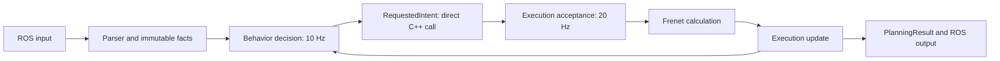

# asmc_planner

`asmc_planner` owns the integrated candidate production executable and all
Behavior, Execution, Frenet, Planning, Parser and output implementations.
`behavior_planner` and `frenet_planner` retain compatibility entry points,
headers, schemas and regression tests; neither is a production dependency.
The original scaffold still exits immediately. Phase 8 status and validation
are recorded in [REFACTOR_STATUS.md](REFACTOR_STATUS.md).

## Target ownership

| Directory | Responsibility |
| --- | --- |
| `src/Global/` | Shared internal types; no mutable global runtime state. |
| `src/Parser/` | Convert external ROS messages and data to internal values. |
| `src/Behavior/Map/`, `src/Frenet/Map/` | Existing map/route logic with its distinct semantics preserved. |
| `src/Behavior/` | Semantic behavior decisions and decision-stability memory only. `Feature`, `Rule`, `Decision`, and `FSM` separate those concerns. |
| `src/Execution/` | Single owner of the active maneuver lifecycle. |
| `src/Frenet/` | Trajectory calculation and calculation-continuity state only. `Pipeline`, `Generator`, `Evaluation`, `Reference`, `Speed`, `Geometry`, and `Math` separate the calculation stages. |
| `src/Planning/` | Top-level orchestration, final planning result, and existing fallback policy. |
| `src/Visualization/` | Debugging and visualization only. |

`config/` and `launch/` now contain the candidate's own resources. For the
LiDAR stack, start the existing bridges and Main, then run:

```bash
roslaunch asmc_planner autonomy_no_bridges_v2.launch objects_source:=lidar traffic_light:=false
```

This starts the GPS/IMU planning state adapter, LiDAR object adapters, integrated
planner and controller together. It currently supports `objects_source:=lidar`.
`traffic_light:=false` skips signal inference; the planner's signal rules remain
active. To reuse an already running `/vehicle/state` producer, add
`state_source:=external state_topic:=/vehicle/state`. Stop previously started
input adapters and the controller before using this combined launch.

The planner-only launch remains `roslaunch asmc_planner planner_v2.launch`.
Stop both legacy planner nodes first. Do not include
legacy Behavior/Frenet launches alongside the candidate. Startup guards reject
that overlap for the standard node names. Keep legacy references until MORAI
validation and the later authorized cleanup.

## GPS mode and control ownership

The production runtime publishes latched `/planning/mode` (`std_msgs/UInt8`):
`0` is NORMAL and `1` is JAMMING. It starts in NORMAL. A raw `/gps`
(`morai_msgs/GPSMessage`) selects JAMMING only when latitude, longitude, and
altitude are all exactly `0.0`; any other received fix selects NORMAL. Missing
GPS does not create a JAMMING transition. The existing NORMAL planning cycle
remains unchanged and continues to produce `/planning/trajectory`.

`asmc_controller` publishes `/ctrl_cmd/normal`. The camera/BBOX controller in
`lane_boundary_adapter` publishes `/ctrl_cmd/jamming` only while JAMMING is
selected. The `asmc_control_selector_node` alone publishes `/ctrl_cmd`. It
forwards each newly received command from the selected source without changing
any CtrlCmd field; it does not replay a command cached before a transition.
`/planning/control_selector/diagnostics` reports mode, selected source, and
whether each input has been received.

The jamming node still receives camera and BBOX observations while inactive,
but skips its actuation-dependent planning/control loop. On activation it
clears transient lane-change progress, timers, cooldown, steering memory and
the previously selected lane; it confirms the actually observed lane again
before driving. Camera observations remain available; BBOX labels are accepted
again only after they match the newly observed own lane. The active lane
geometry, classification, path, steering,
speed, and safety calculations remain unchanged.

`autonomy_no_bridges_v2.launch` now starts the selector and both command
sources. `mode_control_integration.launch` is a small wrapper exposing the
camera geometry hash and calibration arguments. Raw camera boundary production
and the GPU detector are separately managed. Calibration and acceptance tools
that publish `/ctrl_cmd` must not run beside this launch.

## Shared type audit (Phase 3)

`Global/Global.hpp` is header-only and contains no runtime state. Existing
names remain available through compatibility aliases. Enum values, underlying
types, field order, defaults, and ROS conversion functions are preserved.

| Type | Decision |
| --- | --- |
| BehaviorType | Move the semantic Behavior enum; the two existing BehaviorState enums have different values and meanings and remain separate. |
| ExecutionPhase | Preserve the existing ManeuverPhase vocabulary and alias. It is not PlannerExecutionState, ROS execution_state, or a Frenet maneuver's local phase. |
| LateralDirection / MergeType | Move the Frenet vocabulary, preserving the existing explicit ROS enum mappings and underlying `int` type. |
| ObjectType | Move the Behavior semantic class enum. Frenet's raw integer object class remains unchanged. |
| MotionState | Share Behavior MotionState and Frenet ObjectMotionState: both are uint8, values 0–3, with the same perception-confirmed meaning. The external int32 MotionClassifier enum remains separate. |
| TrafficLightState / SignalMovement | Move the existing signal vocabulary without changing provider or route conversions. |
| Point2D | Share the identical two-double, zero-initialized Cartesian point used by map and geometry calculations. |
| EgoState | Move the existing parser/Behavior/Map snapshot. CartesianState contains curvature and acceleration instead of timestamp/source/validity and is not aliased. |
| TrackedObject / PerceptionObjects | Defer consolidation: Behavior uses category vectors, yaw, acceleration and nonzero size defaults; Frenet uses raw class IDs, heading, Z, yaw rate, authoritative OBB corners and geometry validity. LOW_THREAT speed conversion also differs. |

Feature/scoring/context types, PlannerCommand, transaction types, Frenet paths,
requests and cost weights remain outside Global. Lifecycle values still belong
to their existing runtime owners in Phase 3.

## Behavior state separation (Phase 4)

`Behavior/FSM/DecisionStability` owns emergency-release hysteresis, FOLLOW
observation-drop grace, and the short AVOID-release grace counter. The former
FSM's active behavior, maneuver phase, and bound command ID now live in
`Execution/ManeuverLifecycle`. Conditions, defaults, feedback binding, reset
points, preemption and commit ordering are preserved. The lifecycle invokes
the same AVOID grace calculation at its original place in the cycle.

`Execution/BehaviorFsmCompatibility` retains the existing `Fsm` API and
per-instance lifetime. Legacy BehaviorDecision/BehaviorNode orchestration still
uses that facade. There is one implementation of each operation, and the new
`asmc_planner_behavior_core` library has no ROS dependency.

The state audit also classified FeatureBuilder overlap/recent-lead memory and
HardRuleFilter approach hysteresis as decision stability; their logic stays
untouched. V2CommandManager, Frenet CommandExecutionManager, local maneuver
contexts and node freshness/input state retain their current owners. Combining
those lifecycle owners is Phase 5, not part of this separation.

## Validation through Phase 4

- Full workspace and the runnable Behavior gtest targets rebuild successfully.
- The 41 registered Behavior/Frenet tests remain 39 PASS / 2 FAIL after each
  phase. The failures retain their causes: missing `main` in
  `fsm_command_binding_test`, and the identical 111 AVOID fixture assertions.
- Shared type values, sizes, layouts and defaults match the pre-move snapshot.
  A comparison against the original FSM gives identical outputs for 200,000
  input cycles, including feedback binding, preemption, time reversal and NaN.
- Final explicit v2 ROS regression remains 113/177, with the same 64 failure
  messages. One earlier run returned 112/177: the direct-EXECUTE assertion also
  requires exactly one feedback in a 60 ms window. A temporary diagnostic
  reproduced two WAITING feedbacks (state 2, not COMMITTED state 4) in 3 of 12
  trials. The test has a timing-dependent extra failure; neither the test nor
  production timing was changed to hide it.

The Phase 2 Frenet library's original `-std=c++17 -O2` compilation settings were
also restored before Phase 3; the complete registered baseline was rechecked.

## Phase 5: requested intent and accepted execution

Execution now owns request transaction sequencing, command acceptance, and
the accepted maneuver state. Requested command ID and accepted active command
ID remain independent: a rejected FOLLOW/KEEP request cannot replace a
committed AVOID in SHIFT/PASS/RETURN. Frenet retains geometric targets and
calculation history; its existing transition call sites are separated in Phase 6.
The v2 runtime binds its Frenet view to the acceptance owner's maneuver storage.
Standalone/v1 planners retain independent Execution storage and copy semantics.

Legacy manager headers and target names remain compatibility wrappers. Their
transitive validation include and adapter link dependency are both preserved.
No tests, policy, message definitions, timers or publishers were changed.

Phase 5 validation: full workspace build PASS; registered tests 39 PASS/2 FAIL
with the same missing-main origin and identical 111 AVOID failures; explicit
v2 ROS regression 113/177 with the identical 64 failures. The linked acceptance
implementation matches the old implementation over 200,000 transitions and
1,008 exhaustive cases; the request adapter matches serialized output and IDs
over 200,000 cycles; the original FSM comparison still matches 200,000 cycles.

## Phase 6: facts and lifecycle transitions

Frenet's Execution view is read-only. Geometry, candidate selection, projection,
configuration comparisons, progress calculations and numerical continuity stay
in Frenet. Execution receives facts and owns AVOID entry/SHIFT/PASS/RETURN,
lane-change HOLD, STOP phases, MERGE commit/waiting, target retention and probe
rollback. Existing public Frenet methods remain compatibility delegates; their
call order and commit/coordinator feedback contracts are preserved.

Full workspace build PASS; 39/2 registered results with the same 111 AVOID
assertions and missing-main failure; explicit ROS 113/177 with the identical
64 failures. An additional 200,000 maneuver transitions and 560 exhaustive
fact combinations match the Phase 5 control statements. The acceptance,
request and original FSM equivalence checks also remain unchanged. Tests and
configuration files are untouched.

## Phase 7: Planning coordinator

Planning/Planner owns the existing v1/v2 cycle orchestration. The legacy ROS
node supplies input and output ports; it retains exactly its existing timer,
clock samples and adapters. PlannerContext borrows immutable input facts at
the original snapshot boundary. The latest 10 Hz Behavior request is reused
by intermediate 20 Hz Planning cycles. V1/v2 bodies match the previous runtime
after port qualification and snapshot aliases are reversed. Planner.hpp only
forward-declares ros::Time; the inert scaffold does not need ROS headers.

Full workspace build PASS; registered tests 39/2 with identical 111 AVOID
failures and the existing missing-main failure; explicit ROS 113/177 with
identical 64 failures. All acceptance, request, maneuver and FSM equivalence
checks pass. git diff --check PASS; protected untracked files unchanged.

## Phase 8: one package, internal calls

Required Behavior implementation, the remaining Frenet implementation and the
ROS adapters were migrated into this package. Legacy source headers forward to
these definitions; old library names are empty compatibility shims. There is
no reverse dependency from asmc_planner to either legacy package and no runtime
dependency between those packages.



Behavior and Planning retain separate single-thread adapter queues and their
original SteadyTimers, rates and clock types. Internal request delivery stores
only the latest value; it does not execute planning or accept commands on the
10 Hz Behavior callback. Planning reuses that request at 20 Hz. Feedback is a
direct value call with the original steady receipt clock. There is no
RosIntentHandoff, inter-package composition library, or internal feedback
subscription. The command topic remains an external compatibility mirror/input;
self-originated mirrors are ignored by the input adapter.

`RequestedIntent`, `ExecutionRequest`, `FrenetResult`, immutable contexts and
`PlanningResult` cross C++ call boundaries. Existing generated command and
trajectory structs remain compatibility value types within these interfaces;
this phase does not claim complete removal of ROS types from internal headers.
Object representations, conversion rules and clock semantics remain distinct
where the previous audit required it.

The debug schema is generated privately with its unchanged external
`behavior_planner/UrbanFeatureDebug` datatype. Its generated C++ header is byte
identical to the legacy generator output. Numeric configuration is unchanged;
resource lookup paths now point to this package's copied reference assets.

Validation commands and results are in REFACTOR_STATUS.md. The new
`asmc_internal_flow_equivalence` executable is an explicit offline gate; it is
not added to the existing registered 41-test regression set.
